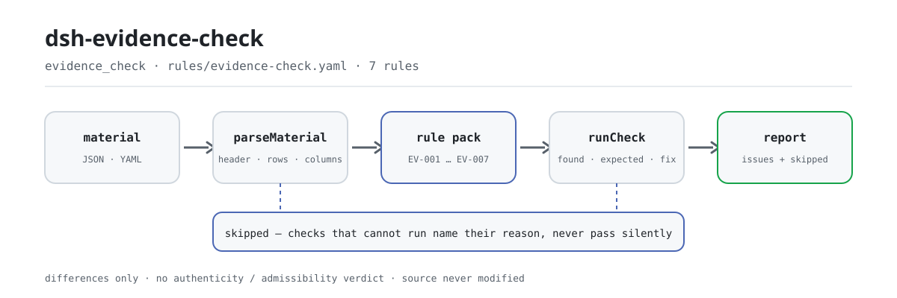

<div align="center">

<picture>
  <source media="(prefers-color-scheme: dark)" srcset="docs/assets/dsh-evidence-check-flow-dark.svg">
  
</picture>

# dsh-evidence-check

**Check an exhibit list row by row for completeness, source, dates and numbering — and get back a list of which row, which column, what is missing.**

A DeepSeek Harness check plugin for lawyers and litigation support: the case header plus one row per exhibit goes in, a rule pack with verbatim citations runs, and what comes back is the list of differences the material itself can be held to — no source file touched, no verdict issued.

[Install](#three-step-setup) · [Configuration](#configuration) · [FAQ](#faq) · [简体中文](README.md) · [English](README.en.md) · [Español](README.es.md) · [Português](README.pt.md) · [हिन्दी](README.hi.md)

[](LICENSE)
[](#compatibility)
[](https://www.npmjs.com/package/dsh-evidence-check)
[](https://github.com/PerryLink/dsh-evidence-check/actions/workflows/ci.yml)
[](#compatibility)

[](https://github.com/PerryLink/dsh-evidence-check/stargazers)
[](https://www.npmjs.com/package/dsh-evidence-check)
[](https://dshfind.com/plugins/PerryLink/dsh-evidence-check?ref=badge)
[](https://securityscorecards.dev/viewer/?uri=github.com/PerryLink/dsh-evidence-check)
[](https://dsh.market/)
[](https://gitee.com/perrylink/dsh-evidence-check)

```sh
dsh plugin --profile <name> add dsh-evidence-check
```

</div>

<sub>Community plugin, not affiliated with DeepSeek. Canonical repository: <https://github.com/PerryLink/dsh-evidence-check> (Gitee is a mirror).</sub>

## What it is

`dsh-evidence-check` reads one exhibit list — the case header plus one row per exhibit — and checks that list's own completeness and internal consistency: that each exhibit carries a name and the fact it is offered to prove (`claim`, `exhibitName`), that its `source` is recorded, that its `form` comes from the vocabulary you configure, that `obtainedAt` parses and does not fall after `submittedAt`, that no `exhibitNo` is repeated, that the header declares `caseNo` and `party`, and that no template placeholder survives in the fact column. It returns the list of what is inconsistent, where, and what to fix; the source file is never modified, it makes no network request and calls no model. It does not decide whether evidence is authentic, lawfully obtained or relevant, whether it proves the fact, or whether it should be admitted or excluded: that is the court's judgement after cross-examination.

## Three-step setup

1. **Install**:

   ```sh
   dsh plugin --profile <name> add dsh-evidence-check
   ```

   The check is also one part of "Documents and Governance Suite" in WorkBuddy / Coze (availability as listed in that marketplace).

2. **Minimal configuration** (the defaults are usable as shipped):

   ```yaml
   - insert:
       - id: dsh-evidence-check
         name: dsh-evidence-check
   ```

   Every tunable lives in the Schemastery schema in `src/config.ts` and works out of the box; per-rule thresholds live in the rule pack under `rules/`.

3. **Verify it mounted**:

   ```sh
   dsh --profile <name> --dump-config | grep 'dsh-evidence-check'
   ```

   Then run the bundled sample once (about a minute):

   ```sh
   node samples/quickstart/run.mjs
   ```

   ```text
   $ node samples/quickstart/run.mjs
   evidence_check: 1 issue(s) — error 0, warn 1, info 0
   skipped: 1
   ```

   The sample input is in `samples/quickstart/input/`, the expected output in `samples/quickstart/expected/result.json`, and the first-run terminal screenshot in [`docs/assets/quickstart.png`](docs/assets/quickstart.png).

**Uninstall**: `dsh plugin --profile <name> remove dsh-evidence-check` (or remove the row from the profile patch).

## Core capabilities

The plugin registers the `evidence_check` tool: it reads one exhibit list (case header plus one row per exhibit), applies a versioned rule pack, and returns a structured report. Material is JSON or YAML; every check that could not run is listed in `skipped` with its reason.

- **The rule pack is data** — all seven checks live in `rules/evidence-check.yaml`, so switching the rule set needs no code change; the pack is validated on load, not trusted.
- **Severity follows the evidence** — a rule based on a derived principle (`derived-from-principle`) is capped at `warn`; one based on institutional configuration (`institutional-configuration`) is capped at `info`; neither is ever labelled `error` (a test asserts it).
- **An empty issue list is not "nothing is wrong"** — every check that cannot run reports itself in `skipped` with its reason; `EV-003` ships with an empty `values`, so it reports itself in `skipped` rather than passing silently.
- **No adjudicating wording** — the report lists differences and never pronounces on compliance, liability or correctness; a wording guard forces the report to carry its disclaimer.
- **No fabricated citations** — every rule carries `document` / `number` / `clause` / `excerpt` / `kind` / `source`; `excerpt` must be a verbatim quotation, and when the text is not in hand the pack says so instead of presenting a paraphrase as a quotation.

```text
exhibit list (JSON/YAML) ──evidence_check──▶ rule pack EV-001…EV-007 ──▶ report (issues + skipped)
         ▲                                                                          │
         └──────────────────────────── source is read-only, never modified ────────┘
```

### Rules at a glance

| Rule | What it checks | Severity | Basis kind |
|---|---|---|---|
| `EV-001` | every exhibit names itself and its fact | warn | verbatim clause |
| `EV-002` | every exhibit records its source | warn | verbatim clause |
| `EV-003` | the form comes from your vocabulary (off by default) | info | institutional configuration |
| `EV-004` | the acquisition date parses and is not later than submission | warn | derived principle |
| `EV-005` | exhibit numbers are unique within the list | warn | derived principle |
| `EV-006` | the list declares its case number and filing party | warn | derived principle |
| `EV-007` | the fact column holds no unreplaced placeholder | warn | derived principle |

### Examples

These are the plugin's real entry points; install once, then call one. The output below is the plugin's real run against its own `EV-001` test fixture, not an illustration.

**Detailed output** — tool `evidence_check`, input:

```json
{"rows":[{"证据编号":"证1","待证事实":"","证据名称":""}]}
```

Output:

```json
{
  "id": "dsh-evidence-check.EV-001.de09b5a6",
  "ruleId": "EV-001",
  "severity": "warn",
  "locator": {
    "field": "claim",
    "row": 1
  },
  "found": "第 1 行 claim、exhibitName 都为空",
  "expected": "claim、exhibitName 至少应填写一项",
  "fix": "补填证据名称与待证事实；本条只核对是否填写，不判断证据是否足以证明"
}
```

*Observed from `tests/fixtures/EV-001/EV-001-unsafe.json (cases.json expects EV-001 count 1); run via lib/index.mjs rules/evidence-check.yaml`*

### What it answers

| You ask | What it answers |
|---|---|
| We filed inside the period the court set. Will this tool confirm that? | No. `EV-004` only checks that the two date columns the list itself carries can be parsed and that `obtainedAt` is not later than `submittedAt`; it computes no evidence period, because that period is set by the court's notice or agreed by the parties, with extensions and suspensions of its own. A day-by-day reading of the list is therefore not a finding about timeliness. |
| The exhibit name is filled in but the fact column is blank. | `EV-001` covers `claim` and `exhibitName` together and asks only that at least one of the two be filled; it reports a row where both cells are empty, and does not judge whether the exhibit is enough to prove the fact. |
| Two rows carry the same exhibit number. | `EV-005` compares the `exhibitNo` values inside the list, ignoring whitespace, and reports the later row with the row it duplicates. It only establishes that the number is not unique — whether that is a double registration or a mis-copied number is left to you. A blank number cell is not part of that comparison. |
| The source of this exhibit is obvious, yet the rule fires. | Because the source cell is not filled. `EV-002` requires a `source` on every exhibit the list gives that column to; it checks that the cell has content, not that the source is lawful or that the way it was obtained was proper. |
| Our list has no case number or filing party in its header. | `EV-006` reads the header and reports whichever of `caseNo` and `party` the material does not declare. It checks the declaration, not whether what is declared is correct, and a missing declaration is reported once for the header rather than row by row. |
| Which rule reports `skipped`, and why? | `EV-003` does by default: its `values` ship empty, which means the form vocabulary is unconfigured, and the plugin will not hard-code a list of kinds of evidence because civil, administrative and criminal procedure do not enumerate the same ones. Fill `values` with your procedure's own kinds and the rule runs; it then checks only that each `form` cell is one of them, not which kind a piece of evidence really is. |

## Configuration

Every tunable lives in the Schemastery schema in `src/config.ts`, so it can be changed from `cordis.yml` without editing code; per-rule thresholds live in the rule pack under `rules/`. There are exactly five configuration keys, in the table below; rule-level parameters follow it.

| Key | Type | Default | Description |
|---|---|---|---|
| `rulesFile` | string | `rules/evidence-check.yaml` | Rule-pack path, relative to the package root |
| `disabledRules` | string[] | `[]` | Rule ids to stop running; each appears in `skipped` |
| `onlyRules` | string[] | `[]` | Run only these rule ids; empty runs every rule |
| `skipNotes` | string | `""` | Note appended to every `skipped` reason |
| `timeoutMs` | number | `120000` | Cooperative tool timeout budget |

Rule-level parameters worth knowing:

- `EV-003` `values` — your procedure's kinds of evidence; empty means the rule does not run and appears in `skipped`.
- `EV-004` `field` / `notAfterField` — the date pair, acquisition against submission by default; the same day counts as not later.
- `EV-007` `terms` — the placeholders to look for.

Example values for `EV-003` (civil procedure) and `EV-007`:

```yaml
values: [书证, 物证, 视听资料, 电子数据, 证人证言, 鉴定意见, 勘验笔录]
terms: ['【', '】', '{{', '}}', 'XXX', '待填', 'TBD']
```

## FAQ

<details>
<summary>Will my material be modified or uploaded?</summary>

No. The tool only reads the JSON/YAML material text you pass in and **never modifies the source file**; the plugin is pure ESM with no native code, **no network access and no model call** (see "Compatibility"), so the material never leaves your machine.

</details>

<details>
<summary>With no form vocabulary configured, will it pass silently?</summary>

No. `EV-003` ships with an empty `values`, so the rule reports itself in `skipped` with its reason — an empty issue list cannot be read as "nothing is missing". Fill `values` with your procedure's kinds and the rule starts running; from then on it only checks that each `form` cell is one of them, not which kind a piece of evidence actually is.

</details>

<details>
<summary>The plugin is installed but the tool never appears. What now?</summary>

Check that `main` resolves to `lib/index.mjs` and that `pnpm run build` produced it; a wrong `main` makes the loader skip the entry silently.

</details>

<details>
<summary>Installation says the package is incompatible. What now?</summary>

The peer range covers `0.1.x` and `0.2.x`; if your runtime sits outside it, grant an explicit exemption: `dsh plugin --profile <name> allow-version dsh-evidence-check@0.1.0 --dsh-version <runtime> --accept-risk`. Peer compatibility at install time is enforced by the runtime.

</details>

<details>
<summary>Can it handle a whole list, or a directory of them, in one run?</summary>

The tool works in `native` and `ptc` mode; for a large set of documents prefer `ptc`, so the schema cost is paid once. All arithmetic is wall-clock arithmetic on the supplied strings, with no time-zone conversion.

</details>

## Standards it follows

| Document | Number | Cited by rules |
|---|---|---|
| Provisions of the Supreme People's Court on Evidence in Civil Proceedings | Fa Shi [2019] No. 19 (version and clause-number verification status differs per rule — see each rule's `number` field) | EV-001, EV-002, EV-004, EV-005, EV-006, EV-007 |
| Provisions of the Supreme People's Court on Evidence in Civil Proceedings | Fa Shi [2019] No. 19 (in force since 1 May 2020) | EV-003 |

**Boundary:** this plugin checks an exhibit list for what a list can be held to mechanically — that every exhibit names itself and the fact it is offered to prove, that its source is recorded, that its form comes from your vocabulary, that acquisition precedes submission, that exhibit numbers are unique, that the list names its case and the party filing it, and that no placeholder survives. It does **not** decide whether evidence is authentic, lawfully obtained or relevant, whether it proves the fact, or whether it should be admitted or excluded. **That is the court's judgement after cross-examination, and it is the heart of the case.**

> ### ⚠️ Read this before trusting a citation in the report
>
> **`excerpt` status is per rule, not uniform.** Some rules quote the clause verbatim (`kind: direct`), some are derived from the principle of the cited articles (`kind: derived-from-principle`, capped at `warn`), and some use thresholds your institution configures (`kind: institutional-configuration`, capped at `info`). The pack never paraphrases a quotation: when the text was not obtained, the `excerpt` field says so and the reasoning lives in `note`; a test asserts that no rule claims a quotation it does not have. **For any rule still marked as not obtained, replace the `excerpt` with the real clause and raise `kind` to `direct` once the text is in hand.**
>
> The conclusion is the reviewer's: this plugin lists differences it can point to in the material and does not decide facts or compliance.

## Material format

The tool accepts JSON or YAML:

```yaml
caseNo: （2026）某民初 1234 号
caseName: 买卖合同纠纷
party: 原告某某公司
rows:
  - { 证据编号: 证1, 待证事实: 双方于 2025 年 3 月 10 日签订买卖合同,
      证据名称: 买卖合同原件, 证据形式: 书证, 来源: 原告留存，签订时取得,
      页码: 第 1-3 页, 原件: 原件, 取得日期: 2025-03-10, 提交日期: 2026-03-02 }
```

Column names are matched case-insensitively and ignoring spaces, underscores and hyphens; the list's own column names are kept, so a finding names the column it read. Dates may be `2026-03-02` or `2026-03-02 09:30`. Fields are optional at the reading layer and validated by the check engine, so a partial export produces findings about what is missing instead of crashing.

## Rule sources

Rule data lives in `rules/evidence-check.yaml`, separate from the code. Every rule carries the document, its number, the clause in the source's own numbering, a verbatim `excerpt`, a source URL and a basis kind (`kind`). The load-time guard enforces that an `excerpt` is a real quotation of at least eight characters, and that a check based only on a derived principle (`derived-from-principle`, severity capped at `warn`) or on institutional configuration (`institutional-configuration`, capped at `info`) is never labelled `error`. A pack that overstates its basis fails at load instead of producing a confident-looking report.

The `check:citations` gate further requires every excerpt segment to be found verbatim in the clause-verification record under `rules/evidence/`; `rules/citations-baseline.json` records segments that are not yet traceable, and that baseline may only shrink.

The cited clauses come from the Provisions of the Supreme People's Court on Evidence in Civil Proceedings (Fa Shi [2019] No. 19): Articles 1, 11, 14 and 19, plus the list-relevant articles among Articles 50 to 57. The boundaries confirmed during verification, and the conclusions deliberately not drawn, are recorded in `rules/evidence/`.

## Compatibility

| Surface | Status |
|---|---|
| Harness | Peer range `>=0.1.2-rc.1 <0.2.0 \|\| >=0.2.0-0 <0.3.0` — verified to accept both `0.2.0-rc.2` and `0.2.1-rc.2`. `engines.dsh` is declared as `>=0.2.1-0 <0.3.0` and is enforced by the host since 0.2.1 |
| Node | `^22.19.0 \|\| >=24.0.0` |
| Platforms | All (plain ESM; no native code, no network, no model call) |
| Tool mode | Works in `native` and `ptc`; for a large set of documents prefer `ptc`, so the schema cost is paid once |

## Troubleshooting

- **`EV-003` never runs.** Its vocabulary is empty. Kinds of evidence differ between civil, administrative and criminal procedure, so the plugin will not impose a list; fill in your procedure's `values` in the rule pack.
- **`EV-004` fires although I filed within the period.** The rule does not know the period; it only compares the two date cells the list carries. If acquisition really postdates submission, one of the two is wrong.
- **`EV-002` fires on an exhibit whose source is obvious.** A blank source cell means the list does not say where the exhibit came from, which is exactly what a list has to say.
- **`EV-005` fires twice on one exhibit number.** Numbering a supplementary bundle with the same number is common; correct the number rather than relying on the remark.
- **The plugin installs but the tool never appears.** Check that `main` resolves to `lib/index.mjs` and that `pnpm run build` produced it; a wrong `main` makes the loader skip the entry silently.
- **`dsh plugin add` refuses the package as incompatible.** The peer range covers `0.1.x` and `0.2.x`; if your runtime sits outside it, grant an explicit exemption: `dsh plugin --profile <name> allow-version dsh-evidence-check@0.1.0 --dsh-version <runtime> --accept-risk`
- **A rule did not run.** Read the `skipped` array; it names the rule id and the reason.
- **`check` reports `manifest-peers` as failed.** The static checker compares against a hard-coded peer range that predates the 0.2 line. The runtime enforces peer compatibility at install time; this is a known upstream issue in `dsh-plugin-dev`.
- **Times look shifted.** All arithmetic is wall-clock arithmetic on the supplied strings, with no time-zone conversion.

## Ecosystem & quality

- [Gitee mirror](https://gitee.com/perrylink/dsh-evidence-check) (sync mirror; GitHub is canonical)
- [dshfind plugin page](https://dshfind.com/plugins/PerryLink/dsh-evidence-check) (installs and ranking)
- [OpenSSF Scorecard report](https://securityscorecards.dev/viewer/?uri=github.com/PerryLink/dsh-evidence-check) (driven by [.github/workflows/scorecard.yml](.github/workflows/scorecard.yml))
- [DSH Market](https://dsh.market/) (listed)
- [Ecosystem knowledge base · choose a checker by material](https://perrylink.github.io/zh/checkers/choose/) (the whole family: checkers plus general plugins)

## Development

```sh
pnpm install
pnpm run typecheck   # tsc --noEmit
pnpm test            # vitest; every rule has paired compliant/violating fixtures under tests/fixtures/<RULE>/
pnpm run build       # tsdown -> lib/index.mjs + lib/index.d.mts
pnpm run check:readmes   # five-language README consistency
node ../scripts/sync-shared.mjs dsh-evidence-check   # refresh src/shared from ../_shared
```

The plugin is **data-only**: `src/model.ts` declares the table shape, the shared kit supplies the reader and the check engine, and the rule pack declares every check. The rule pack is data, not code: replacing `rules/*.yaml` switches the rule set without touching TypeScript, and the pack is validated on load rather than trusted. The README images are generated programmatically by [`scripts/gen-readme-assets.py`](scripts/gen-readme-assets.py) (Python + Pillow) and are safe to re-run; this plugin has no UI, so the hero is a hand-written SVG flow diagram (light and dark, command-surface tokens only).

Topics: `dsh`, `dsh-plugin`, `deepseek-harness`, `cordis`, `evidence`

## Family & thanks

This project is part of the DeepSeek Harness plugin family from [PerryLink](https://github.com/PerryLink) (all Apache-2.0). If it is useful, **a star helps the next person find it** — nothing is gated behind it.

- [@PerryLink](https://github.com/PerryLink) — creator and maintainer: the `evidence_check` tool, the verbatim-citation rule pack and its clause-verification record, and the five-language docs.

<details>
<summary>Expand all plugins</summary>

| Plugin | Status |
|---|---|
| **[dsh-aqua-input-check](https://github.com/PerryLink/dsh-aqua-input-check)** |  |
| **[dsh-archive-check](https://github.com/PerryLink/dsh-archive-check)** |  |
| **[dsh-auto-review](https://github.com/PerryLink/dsh-auto-review)** |  |
| **[dsh-autotier](https://github.com/PerryLink/dsh-autotier)** | 🧊 FROZEN — see the repo README |
| **[dsh-bid-ca-precheck](https://github.com/PerryLink/dsh-bid-ca-precheck)** |  |
| **[dsh-bid-qual-check](https://github.com/PerryLink/dsh-bid-qual-check)** |  |
| **[dsh-cert-mcp](https://github.com/PerryLink/dsh-cert-mcp)** | 🧊 FROZEN — see the repo README |
| **[dsh-checkpoint-rewind](https://github.com/PerryLink/dsh-checkpoint-rewind)** |  |
| **[dsh-click](https://github.com/PerryLink/dsh-click)** |  |
| **[dsh-composer-history](https://github.com/PerryLink/dsh-composer-history)** |  |
| **[dsh-contract-stance](https://github.com/PerryLink/dsh-contract-stance)** |  |
| **[dsh-customs-doc-check](https://github.com/PerryLink/dsh-customs-doc-check)** |  |
| **[dsh-data-quality](https://github.com/PerryLink/dsh-data-quality)** | 🧊 FROZEN — see the repo README |
| **[dsh-demurrage-ledger](https://github.com/PerryLink/dsh-demurrage-ledger)** |  |
| **[dsh-doublecheck](https://github.com/PerryLink/dsh-doublecheck)** |  |
| **[dsh-drill-script-check](https://github.com/PerryLink/dsh-drill-script-check)** |  |
| **[dsh-eia-guide-check](https://github.com/PerryLink/dsh-eia-guide-check)** |  |
| **[dsh-emergency-plan](https://github.com/PerryLink/dsh-emergency-plan)** |  |
| **[dsh-essay-rubric-check](https://github.com/PerryLink/dsh-essay-rubric-check)** |  |
| **[dsh-evidence-check](https://github.com/PerryLink/dsh-evidence-check)** |  |
| **[dsh-export-ctl-check](https://github.com/PerryLink/dsh-export-ctl-check)** |  |
| **[dsh-fast](https://github.com/PerryLink/dsh-fast)** |  |
| **[dsh-fmea-table-check](https://github.com/PerryLink/dsh-fmea-table-check)** |  |
| **[dsh-forecast-penalty](https://github.com/PerryLink/dsh-forecast-penalty)** |  |
| **[dsh-fund-research](https://github.com/PerryLink/dsh-fund-research)** |  |
| **[dsh-github](https://github.com/PerryLink/dsh-github)** |  |
| **[dsh-gongwen-flow-check](https://github.com/PerryLink/dsh-gongwen-flow-check)** |  |
| **[dsh-gongwen-word-check](https://github.com/PerryLink/dsh-gongwen-word-check)** |  |
| **[dsh-guard-plan-qc](https://github.com/PerryLink/dsh-guard-plan-qc)** |  |
| **[dsh-hazchem-check](https://github.com/PerryLink/dsh-hazchem-check)** |  |
| **[dsh-hazplan-check](https://github.com/PerryLink/dsh-hazplan-check)** |  |
| **[dsh-hidden-risk-map](https://github.com/PerryLink/dsh-hidden-risk-map)** |  |
| **[dsh-hs-classify](https://github.com/PerryLink/dsh-hs-classify)** |  |
| **[dsh-icd-rule-check](https://github.com/PerryLink/dsh-icd-rule-check)** |  |
| **[dsh-industry-research](https://github.com/PerryLink/dsh-industry-research)** |  |
| **[dsh-lawcite-adapter](https://github.com/PerryLink/dsh-lawcite-adapter)** |  |
| **[dsh-laya](https://github.com/PerryLink/dsh-laya)** |  |
| **[dsh-lc-doc-check](https://github.com/PerryLink/dsh-lc-doc-check)** |  |
| **[dsh-learning-gap-check](https://github.com/PerryLink/dsh-learning-gap-check)** |  |
| **[dsh-library](https://github.com/PerryLink/dsh-library)** |  |
| **[dsh-local-ai](https://github.com/PerryLink/dsh-local-ai)** |  |
| **[dsh-lsp-actions](https://github.com/PerryLink/dsh-lsp-actions)** |  |
| **[dsh-mask](https://github.com/PerryLink/dsh-mask)** |  |
| **[dsh-mcp-panel](https://github.com/PerryLink/dsh-mcp-panel)** |  |
| **[dsh-medrec-qc](https://github.com/PerryLink/dsh-medrec-qc)** |  |
| **[dsh-memento](https://github.com/PerryLink/dsh-memento)** | 🧊 FROZEN — see the repo README |
| **[dsh-nsfc-form-check](https://github.com/PerryLink/dsh-nsfc-form-check)** |  |
| **[dsh-nurse-record-check](https://github.com/PerryLink/dsh-nurse-record-check)** |  |
| **[dsh-observe](https://github.com/PerryLink/dsh-observe)** |  |
| **[dsh-origin-rvc-check](https://github.com/PerryLink/dsh-origin-rvc-check)** |  |
| **[dsh-ota-review-check](https://github.com/PerryLink/dsh-ota-review-check)** |  |
| **[dsh-output-styles](https://github.com/PerryLink/dsh-output-styles)** |  |
| **[dsh-paper-doc-adapter](https://github.com/PerryLink/dsh-paper-doc-adapter)** |  |
| **[dsh-permission-rules](https://github.com/PerryLink/dsh-permission-rules)** |  |
| **[dsh-permit-report-check](https://github.com/PerryLink/dsh-permit-report-check)** |  |
| **[dsh-pipeline-check](https://github.com/PerryLink/dsh-pipeline-check)** |  |
| **[dsh-pleading-draft](https://github.com/PerryLink/dsh-pleading-draft)** |  |
| **[dsh-plugin-doctor](https://github.com/PerryLink/dsh-plugin-doctor)** | 🚫 RETIRED (repo archived) |
| **[dsh-plugin-guide](https://github.com/PerryLink/dsh-plugin-guide)** |  |
| **[dsh-plugin-kit](https://github.com/PerryLink/dsh-plugin-kit)** | 🚫 RETIRED (repo archived) |
| **[dsh-plugin-upgrade](https://github.com/PerryLink/dsh-plugin-upgrade)** | 🚫 RETIRED (repo archived) |
| **[dsh-policy-brief-draft](https://github.com/PerryLink/dsh-policy-brief-draft)** |  |
| **[dsh-power-loss-split](https://github.com/PerryLink/dsh-power-loss-split)** |  |
| **[dsh-power-ticket-check](https://github.com/PerryLink/dsh-power-ticket-check)** |  |
| **[dsh-ppap-check](https://github.com/PerryLink/dsh-ppap-check)** |  |
| **[dsh-protest-deadline](https://github.com/PerryLink/dsh-protest-deadline)** |  |
| **[dsh-railway-window](https://github.com/PerryLink/dsh-railway-window)** |  |
| **[dsh-repair-order-qc](https://github.com/PerryLink/dsh-repair-order-qc)** |  |
| **[dsh-research-report](https://github.com/PerryLink/dsh-research-report)** |  |
| **[dsh-review-reply-check](https://github.com/PerryLink/dsh-review-reply-check)** |  |
| **[dsh-rulefile-check](https://github.com/PerryLink/dsh-rulefile-check)** |  |
| **[dsh-safety-brief-check](https://github.com/PerryLink/dsh-safety-brief-check)** |  |
| **[dsh-score](https://github.com/PerryLink/dsh-score)** | 🧊 FROZEN — see the repo README |
| **[dsh-session-sync](https://github.com/PerryLink/dsh-session-sync)** |  |
| **[dsh-site-log-check](https://github.com/PerryLink/dsh-site-log-check)** |  |
| **[dsh-skill-pack-security](https://github.com/PerryLink/dsh-skill-pack-security)** |  |
| **[dsh-soe-decision-check](https://github.com/PerryLink/dsh-soe-decision-check)** |  |
| **[dsh-soilwater-check](https://github.com/PerryLink/dsh-soilwater-check)** |  |
| **[dsh-sop-sync-check](https://github.com/PerryLink/dsh-sop-sync-check)** |  |
| **[dsh-spc-gbt-adapter](https://github.com/PerryLink/dsh-spc-gbt-adapter)** |  |
| **[dsh-talk](https://github.com/PerryLink/dsh-talk)** |  |
| **[dsh-tender-extract](https://github.com/PerryLink/dsh-tender-extract)** |  |
| **[dsh-tender-matrix](https://github.com/PerryLink/dsh-tender-matrix)** |  |
| **[dsh-test-drive](https://github.com/PerryLink/dsh-test-drive)** |  |
| **[dsh-ticktick](https://github.com/PerryLink/dsh-ticktick)** | 🚫 RETIRED (repo archived) |
| **[dsh-translate](https://github.com/PerryLink/dsh-translate)** |  |
| **[dsh-warranty-calc](https://github.com/PerryLink/dsh-warranty-calc)** |  |
| **[dsh-budget](https://github.com/PerryLink/dsh-budget)** | 🧊 FROZEN — see the repo README |
| **[dsh-claude-move](https://github.com/PerryLink/dsh-claude-move)** | 🧊 FROZEN — see the repo README |
| **[dsh-defend](https://github.com/PerryLink/dsh-defend)** | 🧊 FROZEN — see the repo README |
| **[dsh-draw](https://github.com/PerryLink/dsh-draw)** | 🧊 FROZEN — see the repo README |
| **[dsh-reach](https://github.com/PerryLink/dsh-reach)** | 🧊 FROZEN — see the repo README |
| **[dsh-background-agents](https://github.com/PerryLink/dsh-background-agents)** | 🚫 RETIRED (repo archived) |
| **[dsh-session-pin](https://github.com/PerryLink/dsh-session-pin)** | 🚫 RETIRED (repo archived) |
| **[dsh-team-rooms](https://github.com/PerryLink/dsh-team-rooms)** | 🚫 RETIRED (repo archived) |

</details>

## License

[LICENSE](LICENSE) (Apache License 2.0) © 2026 dsh-evidence-check contributors

<p align="center"><sub>Apache-2.0 · Community plugin, not affiliated with DeepSeek.</sub></p>
