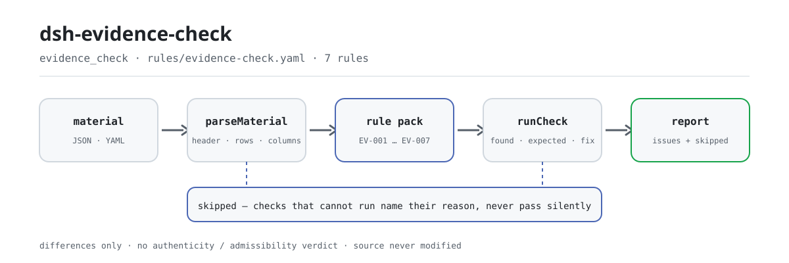

<div align="center">

<picture>
  <source media="(prefers-color-scheme: dark)" srcset="docs/assets/dsh-evidence-check-flow-dark.svg">
  
</picture>

# dsh-evidence-check

**Revisa una lista de pruebas fila por fila —completitud, origen, fechas y numeración— y devuelve qué fila, qué columna y qué falta.**

Un plugin de verificación para DeepSeek Harness, pensado para abogados y equipos de apoyo procesal: entra la cabecera del caso más una fila por prueba, se aplica un paquete de reglas con citas literales y sale la lista de divergencias que el propio material permite señalar —sin tocar el original y sin emitir un veredicto.

[Instalar](#instalación-en-tres-pasos) · [Configuración](#configuración) · [FAQ](#faq) · [简体中文](README.md) · [English](README.en.md) · [Español](README.es.md) · [Português](README.pt.md) · [हिन्दी](README.hi.md)

[](LICENSE)
[](#compatibilidad)
[](https://www.npmjs.com/package/dsh-evidence-check)
[](https://github.com/PerryLink/dsh-evidence-check/actions/workflows/ci.yml)
[](#compatibilidad)

[](https://github.com/PerryLink/dsh-evidence-check/stargazers)
[](https://www.npmjs.com/package/dsh-evidence-check)
[](https://dshfind.com/plugins/PerryLink/dsh-evidence-check?ref=badge)
[](https://securityscorecards.dev/viewer/?uri=github.com/PerryLink/dsh-evidence-check)
[](https://dsh.market/)
[](https://gitee.com/perrylink/dsh-evidence-check)

```sh
dsh plugin --profile <name> add dsh-evidence-check
```

</div>

<sub>Plugin de la comunidad, no afiliado a DeepSeek. Repositorio canónico: <https://github.com/PerryLink/dsh-evidence-check> (Gitee es un espejo).</sub>

## Qué es

`dsh-evidence-check` lee una lista de pruebas —la cabecera del caso más una fila por prueba— y comprueba la completitud y la coherencia interna de esa lista: que cada prueba lleve nombre y el hecho que pretende probar (`claim`, `exhibitName`), que su `source` esté registrado, que su `form` provenga del vocabulario que usted configure, que `obtainedAt` se pueda analizar y no sea posterior a `submittedAt`, que no se repita ningún `exhibitNo`, que la cabecera declare `caseNo` y `party`, y que no quede ningún marcador de plantilla en la columna del hecho. Devuelve la lista de lo que es incoherente, dónde y qué corregir; no modifica el original, no hace peticiones de red y no llama a ningún modelo. No decide si la prueba es auténtica, si se obtuvo lícitamente o si es pertinente, ni si prueba el hecho, ni si debe admitirse o excluirse: eso lo juzga el tribunal tras el careo.

## Instalación en tres pasos

1. **Instalar**:

   ```sh
   dsh plugin --profile <name> add dsh-evidence-check
   ```

   La verificación también forma parte de «Documents and Governance Suite» en WorkBuddy / Coze (disponibilidad según ese mercado).

2. **Configuración mínima** (los valores por defecto ya sirven):

   ```yaml
   - insert:
       - id: dsh-evidence-check
         name: dsh-evidence-check
   ```

   Todos los parámetros ajustables viven en el esquema Schemastery de `src/config.ts` y funcionan tal cual; los umbrales por regla están en el paquete de reglas bajo `rules/`.

3. **Verificar que se montó**:

   ```sh
   dsh --profile <name> --dump-config | grep 'dsh-evidence-check'
   ```

   Después ejecute una vez el ejemplo incluido (unos 2 minutos como máximo):

   ```sh
   node samples/quickstart/run.mjs
   ```

   ```text
   $ node samples/quickstart/run.mjs
   evidence_check: 1 issue(s) — error 0, warn 1, info 0
   skipped: 1
   ```

   La entrada del ejemplo está en `samples/quickstart/input/`, la salida esperada en `samples/quickstart/expected/result.json` y la captura de la primera ejecución en [`docs/assets/quickstart.png`](docs/assets/quickstart.png).

**Desinstalar**: `dsh plugin --profile <name> remove dsh-evidence-check` (o elimine la fila del patch del perfil).

## Capacidades clave

El plugin registra la herramienta `evidence_check`: lee una lista de pruebas (cabecera del caso más una fila por prueba), aplica un paquete de reglas versionado y devuelve un informe estructurado. El material es JSON o YAML; toda comprobación que no pudo ejecutarse aparece en `skipped` con su motivo.

- **El paquete de reglas es datos** — las siete comprobaciones viven en `rules/evidence-check.yaml`, así que cambiar el conjunto de reglas no exige tocar código; el paquete se valida al cargar, no se da por bueno.
- **La gravedad sigue a la prueba** — una regla basada en un principio derivado (`derived-from-principle`) queda topada en `warn`; una basada en configuración institucional (`institutional-configuration`) queda topada en `info`; ninguna se etiqueta jamás como `error` (hay un test que lo afirma).
- **Una lista vacía no significa «no hay nada mal»** — cada comprobación que no puede ejecutarse se declara en `skipped` con su motivo; `EV-003` sale de fábrica con `values` vacío, así que se declara en `skipped` en lugar de pasar en silencio.
- **Sin lenguaje que adjudique** — el informe enumera diferencias y nunca se pronuncia sobre cumplimiento, responsabilidad o corrección; un guardián de redacción obliga a que el informe lleve siempre su aviso.
- **Sin citas inventadas** — cada regla lleva `document` / `number` / `clause` / `excerpt` / `kind` / `source`; `excerpt` debe ser una cita literal, y cuando el texto no se tiene el paquete lo dice en lugar de presentar una paráfrasis como cita.

```text
lista de pruebas (JSON/YAML) ──evidence_check──▶ reglas EV-001…EV-007 ──▶ informe (issues + skipped)
         ▲                                                                          │
         └──────────────────────────── original de solo lectura, nunca se modifica ─┘
```

### Reglas de un vistazo

| Regla | Qué comprueba | Gravedad | Tipo de base |
|---|---|---|---|
| `EV-001` | cada prueba se nombra y enuncia su hecho | warn | cláusula literal |
| `EV-002` | cada prueba registra su origen | warn | cláusula literal |
| `EV-003` | la forma proviene de su vocabulario (desactivada por defecto) | info | configuración institucional |
| `EV-004` | la fecha de obtención se analiza y no es posterior a la de presentación | warn | principio derivado |
| `EV-005` | los números de prueba son únicos en la lista | warn | principio derivado |
| `EV-006` | la lista declara número de caso y parte que la presenta | warn | principio derivado |
| `EV-007` | la columna del hecho no conserva marcadores sin sustituir | warn | principio derivado |

### Ejemplos

Estas son las entradas reales del plugin; instálelo una vez y llame a una. La salida siguiente es la ejecución real del plugin sobre su propio fixture de prueba `EV-001`, no una ilustración.

**Salida detallada** — herramienta `evidence_check`, entrada:

```json
{"rows":[{"证据编号":"证1","待证事实":"","证据名称":""}]}
```

Salida:

```json
{
  "id": "dsh-evidence-check.EV-001.de09b5a6",
  "ruleId": "EV-001",
  "severity": "warn",
  "locator": {
    "field": "claim",
    "row": 1
  },
  "found": "第 1 行 claim、exhibitName 都为空",
  "expected": "claim、exhibitName 至少应填写一项",
  "fix": "补填证据名称与待证事实；本条只核对是否填写，不判断证据是否足以证明"
}
```

*Observed from `tests/fixtures/EV-001/EV-001-unsafe.json (cases.json expects EV-001 count 1); run via lib/index.mjs rules/evidence-check.yaml`*

### Qué responde

| Usted pregunta | Qué responde |
|---|---|
| Presentamos dentro del plazo que fijó el tribunal. ¿Lo confirmará esta herramienta? | No. `EV-004` comprueba únicamente que las dos columnas de fecha que la propia lista trae se puedan analizar y que `obtainedAt` no sea posterior a `submittedAt`; no calcula ningún plazo de prueba, porque ese plazo lo fija el tribunal o lo acuerdan las partes, con prórrogas y suspensiones propias. Una lectura día a día de la lista no es, por tanto, una conclusión sobre la oportunidad. |
| El nombre de la prueba está puesto, pero la columna del hecho está vacía. | `EV-001` cubre `claim` y `exhibitName` en conjunto y solo pide que al menos uno de los dos esté relleno; informa de la fila en la que ambas celdas están vacías y no juzga si la prueba basta para probar el hecho. |
| Dos filas llevan el mismo número de prueba. | `EV-005` compara los valores de `exhibitNo` dentro de la lista, ignorando los espacios, e informa de la fila posterior junto con aquella que duplica. Solo acredita que el número no es único: si se trata de un doble registro o de un número mal copiado queda a su criterio. Una celda de número vacía no entra en esa comparación. |
| El origen de esta prueba es evidente y, aun así, la regla salta. | Porque la celda de origen no está rellena. `EV-002` exige un `source` en cada prueba a la que la lista dé esa columna; comprueba que la celda tenga contenido, no que la fuente sea lícita ni que la forma de obtenerla haya sido correcta. |
| Nuestra lista no trae número de caso ni parte que la presenta en la cabecera. | `EV-006` lee la cabecera e informa de cuál de `caseNo` y `party` no declara el material. Comprueba la declaración, no si lo declarado es correcto, y una declaración ausente se informa una sola vez para la cabecera, no fila por fila. |
| ¿Qué regla informa de `skipped` y por qué? | `EV-003` lo hace de fábrica: sus `values` vienen vacíos, es decir, el vocabulario de formas no está configurado, y el plugin no codifica una lista de clases de prueba porque los procedimientos civil, contencioso-administrativo y penal no enumeran las mismas. Rellene `values` con las clases de su procedimiento y la regla se ejecuta; entonces solo comprueba que cada celda `form` sea una de ellas, no a qué clase pertenece realmente una prueba. |

## Configuración

Todos los parámetros ajustables viven en el esquema Schemastery de `src/config.ts`, por lo que se cambian desde `cordis.yml` sin tocar el código; los umbrales por regla están en el paquete de reglas bajo `rules/`. Hay exactamente cinco claves de configuración, en la tabla siguiente; los parámetros por regla van después.

| Clave | Tipo | Predeterminado | Descripción |
|---|---|---|---|
| `rulesFile` | string | `rules/evidence-check.yaml` | Ruta del paquete de reglas, relativa a la raíz del paquete |
| `disabledRules` | string[] | `[]` | Ids de reglas que se dejan de ejecutar; cada una aparece en `skipped` |
| `onlyRules` | string[] | `[]` | Ejecutar solo estas reglas; vacío ejecuta todas |
| `skipNotes` | string | `""` | Nota añadida a cada motivo de `skipped` |
| `timeoutMs` | number | `120000` | Presupuesto de tiempo de espera cooperativo de la herramienta |

Parámetros por regla que conviene conocer:

- `EV-003` `values` — las clases de prueba de su procedimiento; vacío significa que la regla no se ejecuta y aparece en `skipped`. Ejemplo de procedimiento civil:

  ```yaml
  values: [书证, 物证, 视听资料, 电子数据, 证人证言, 鉴定意见, 勘验笔录]
  ```

- `EV-004` `field` / `notAfterField` — el par de fechas, por defecto obtención frente a presentación; el mismo día cuenta como no posterior.
- `EV-007` `terms` — los marcadores que se buscan:

  ```
  terms: ['【', '】', '{{', '}}', 'XXX', '待填', 'TBD']
  ```

## FAQ

<details>
<summary>¿Se modificará o se subirá mi material?</summary>

No. La herramienta solo lee el texto JSON/YAML que usted entrega y **nunca modifica el original**; el plugin es ESM puro, sin código nativo, **sin red y sin llamada al modelo** (véase «Compatibilidad»), así que el material no sale de su máquina.

</details>

<details>
<summary>Sin vocabulario de formas configurado, ¿pasará en silencio?</summary>

No. `EV-003` trae `values` vacío de fábrica, así que la regla se declara en `skipped` con su motivo: una lista de diferencias vacía no puede leerse como «no falta nada». Rellene `values` con las clases de su procedimiento y la regla empieza a ejecutarse; desde entonces solo comprueba que cada celda `form` sea una de ellas, no a qué clase pertenece realmente una prueba.

</details>

<details>
<summary>El plugin está instalado pero la herramienta no aparece. ¿Qué hago?</summary>

Compruebe que `main` resuelve a `lib/index.mjs` y que `pnpm run build` lo generó; un `main` equivocado hace que el cargador omita la entrada en silencio.

</details>

<details>
<summary>La instalación dice que el paquete es incompatible. ¿Qué hago?</summary>

El rango de peers cubre `0.1.x` y `0.2.x`; si su runtime queda fuera, conceda una exención explícita: `dsh plugin --profile <name> allow-version dsh-evidence-check@0.1.0 --dsh-version <runtime> --accept-risk`. La compatibilidad de peers en la instalación la aplica el runtime.

</details>

<details>
<summary>¿Puede con una lista completa, o con un directorio entero, de una vez?</summary>

La herramienta funciona en modo `native` y `ptc`; para un conjunto grande de documentos conviene `ptc`, así el coste del esquema se paga una vez. Toda la aritmética es de hora local sobre las cadenas entregadas, sin conversión de zona horaria.

</details>

## Normas que sigue

| Documento | Número | Reglas que lo citan |
|---|---|---|
| Provisiones del Tribunal Popular Supremo sobre la prueba en el proceso civil | Fa Shi [2019] No. 19 (el estado de verificación de versión y numeración difiere por regla — véase el campo `number` de cada regla) | EV-001, EV-002, EV-004, EV-005, EV-006, EV-007 |
| Provisiones del Tribunal Popular Supremo sobre la prueba en el proceso civil | Fa Shi [2019] No. 19 (en vigor desde el 1 de mayo de 2020) | EV-003 |

**Límite:** este plugin comprueba una **lista de pruebas** en lo que una lista puede exigirse mecánicamente: que cada prueba se nombre y enuncie el hecho que pretende probar, que su origen quede registrado, que su forma provenga de su vocabulario, que la obtención preceda a la presentación, que los números de prueba sean únicos, que la lista nombre su caso y la parte que la presenta, y que no sobreviva ningún marcador. **No** decide si la prueba es auténtica, si se obtuvo lícitamente o si es pertinente, ni si prueba el hecho, ni si debe admitirse o excluirse. **Eso es el juicio del tribunal tras el careo, y es el núcleo del caso.**

> ### ⚠️ Lea esto antes de fiarse de una cita del informe
>
> **El estado de `excerpt` es por regla, no uniforme.** Algunas reglas citan la cláusula literalmente (`kind: direct`), otras se derivan del principio de los artículos citados (`kind: derived-from-principle`, tope `warn`) y otras usan umbrales que configura su institución (`kind: institutional-configuration`, tope `info`). El paquete nunca parafrasea una cita: cuando el texto no se obtuvo, el campo `excerpt` lo dice y el razonamiento vive en `note`; hay un test que afirma que ninguna regla reclama una cita que no tiene. **Para cualquier regla aún marcada como no obtenida, sustituya el `excerpt` por la cláusula real y suba `kind` a `direct` en cuanto tenga el texto.**
>
> La conclusión es del revisor: este plugin enumera diferencias que puede señalar en el material y no decide hechos ni cumplimiento.

## Formato del material

La herramienta acepta JSON o YAML:

```yaml
caseNo: （2026）某民初 1234 号
caseName: 买卖合同纠纷
party: 原告某某公司
rows:
  - { 证据编号: 证1, 待证事实: 双方于 2025 年 3 月 10 日签订买卖合同,
      证据名称: 买卖合同原件, 证据形式: 书证, 来源: 原告留存，签订时取得,
      页码: 第 1-3 页, 原件: 原件, 取得日期: 2025-03-10, 提交日期: 2026-03-02 }
```

Los nombres de columna se comparan sin distinguir mayúsculas y ignorando espacios, guiones bajos y guiones; se conservan los nombres propios de la lista, de modo que cada hallazgo nombra la columna que leyó. Las fechas pueden ser `2026-03-02` o `2026-03-02 09:30`. Los campos son opcionales en la capa de lectura y los valida el motor, así que una exportación parcial produce hallazgos sobre lo que falta en lugar de fallar.

## Fuentes de las reglas

Los datos de las reglas están en `rules/evidence-check.yaml`, separados del código. Cada regla lleva el documento, su número, la cláusula en la numeración propia de la fuente, un `excerpt` literal, una URL de origen y un tipo de base (`kind`). El cargador impone que el `excerpt` sea una cita real de al menos ocho caracteres y que una comprobación basada solo en un principio derivado (`derived-from-principle`, gravedad topada en `warn`) o en configuración institucional (`institutional-configuration`, topada en `info`) nunca se etiquete `error`. Un paquete que exagera su base falla al cargar en lugar de producir un informe de apariencia segura.

La puerta `check:citations` exige además que cada segmento del excerpt se encuentre literalmente en el registro de verificación de cláusulas bajo `rules/evidence/`; `rules/citations-baseline.json` registra los segmentos aún no rastreables, y esa base solo puede encoger.

Las cláusulas citadas provienen de las Provisiones del Tribunal Popular Supremo sobre la prueba en el proceso civil (Fa Shi [2019] No. 19): artículos 1, 11, 14 y 19, más los artículos pertinentes para la lista entre el 50 y el 57. Los límites confirmados durante la verificación y las conclusiones deliberadamente no extraídas están en `rules/evidence/`.

## Compatibilidad

| Superficie | Estado |
|---|---|
| Harness | Rango de peers `>=0.1.2-rc.1 <0.2.0 \|\| >=0.2.0-0 <0.3.0` — verificado para aceptar tanto `0.2.0-rc.2` como `0.2.1-rc.2`. `engines.dsh` se declara como `>=0.2.1-0 <0.3.0` y el host lo aplica desde 0.2.1 |
| Node | `^22.19.0 \|\| >=24.0.0` |
| Plataformas | Todas (ESM puro; sin código nativo, sin red, sin llamada al modelo) |
| Modo de herramienta | Funciona en `native` y `ptc`; para un conjunto grande de documentos conviene `ptc`, así el coste del esquema se paga una vez |

## Solución de problemas

- **`EV-003` nunca se ejecuta.** Su vocabulario está vacío. Las clases de prueba difieren entre el procedimiento civil, el contencioso-administrativo y el penal, así que el plugin no impone una lista; rellene los `values` de su procedimiento en el paquete de reglas.
- **`EV-004` salta aunque presenté dentro de plazo.** La regla no conoce el plazo; solo compara las dos celdas de fecha que la lista trae. Si la obtención es realmente posterior a la presentación, una de las dos está mal.
- **`EV-002` salta en una prueba cuyo origen es evidente.** Una celda de origen vacía significa que la lista no dice de dónde vino la prueba, que es justo lo que una lista debe decir.
- **`EV-005` salta dos veces en un mismo número de prueba.** Numerar un anexo complementario con el mismo número es habitual; corrija el número en lugar de confiar en la observación.
- **El plugin se instala pero la herramienta no aparece.** Compruebe que `main` resuelve a `lib/index.mjs` y que `pnpm run build` lo generó; un `main` equivocado hace que el cargador omita la entrada en silencio.
- **`dsh plugin add` rechaza el paquete por incompatible.** El rango de peers cubre `0.1.x` y `0.2.x`; si su runtime queda fuera, conceda una exención explícita: `dsh plugin --profile <name> allow-version dsh-evidence-check@0.1.0 --dsh-version <runtime> --accept-risk`
- **Una regla no se ejecutó.** Lea el arreglo `skipped`; nombra el id de la regla y el motivo.
- **`check` informa `manifest-peers` como fallo.** El comprobador estático compara con un rango de peers codificado que es anterior a la línea 0.2; el runtime aplica la compatibilidad de peers al instalar. Es un problema conocido de `dsh-plugin-dev`.
- **Los horarios parecen desplazados.** Toda la aritmética es de hora local sobre las cadenas entregadas, sin conversión de zona horaria.

## Ecosistema y calidad

- [Espejo en Gitee](https://gitee.com/perrylink/dsh-evidence-check) (espejo sincronizado; GitHub es la referencia)
- [Página del plugin en dshfind](https://dshfind.com/plugins/PerryLink/dsh-evidence-check) (instalaciones y ranking)
- [Informe de OpenSSF Scorecard](https://securityscorecards.dev/viewer/?uri=github.com/PerryLink/dsh-evidence-check) (impulsado por [.github/workflows/scorecard.yml](.github/workflows/scorecard.yml))
- [DSH Market](https://dsh.market/) (publicado)
- [Base de conocimiento del ecosistema · elija un verificador por material](https://perrylink.github.io/zh/checkers/choose/) (toda la familia: verificadores y plugins generales)

## Desarrollo

```sh
pnpm install
pnpm run typecheck   # tsc --noEmit
pnpm test            # vitest; cada regla tiene fixtures conformes/infractores en tests/fixtures/<RULE>/
pnpm run build       # tsdown -> lib/index.mjs + lib/index.d.mts
pnpm run check:readmes   # coherencia de los README en cinco idiomas
node ../scripts/sync-shared.mjs dsh-evidence-check   # refresca src/shared desde ../_shared
```

El plugin es **solo datos**: `src/model.ts` declara la forma de la tabla, el kit compartido aporta el lector y el motor de comprobación, y el paquete de reglas declara cada comprobación. El paquete de reglas es datos, no código: reemplazar `rules/*.yaml` cambia el conjunto de reglas sin tocar TypeScript, y el paquete se valida al cargar en lugar de darse por bueno. Las imágenes del README se generan de forma programática con [`scripts/gen-readme-assets.py`](scripts/gen-readme-assets.py) (Python + Pillow) y se pueden volver a ejecutar sin riesgo; este plugin no tiene interfaz, así que el hero es un diagrama de flujo SVG dibujado a mano (claro y oscuro, solo con tokens de la superficie de comandos).

Temas: `dsh`, `dsh-plugin`, `deepseek-harness`, `cordis`, `evidence`

## Familia y agradecimientos

Este proyecto forma parte de la familia de plugins de DeepSeek Harness de [PerryLink](https://github.com/PerryLink) (todos Apache-2.0). Si te resulta útil, **una estrella ayuda a que la siguiente persona lo encuentre** — no desbloquea nada.

- [@PerryLink](https://github.com/PerryLink) — creador y mantenedor: la herramienta `evidence_check`, el paquete de reglas con citas literales y su registro de verificación de cláusulas, y la documentación en cinco idiomas.

<details>
<summary>Expandir todos los plugins</summary>

| Plugin | Estado |
|---|---|
| **[dsh-aqua-input-check](https://github.com/PerryLink/dsh-aqua-input-check)** |  |
| **[dsh-archive-check](https://github.com/PerryLink/dsh-archive-check)** |  |
| **[dsh-auto-review](https://github.com/PerryLink/dsh-auto-review)** |  |
| **[dsh-autotier](https://github.com/PerryLink/dsh-autotier)** | 🧊 CONGELADO — ver el README del repo |
| **[dsh-bid-ca-precheck](https://github.com/PerryLink/dsh-bid-ca-precheck)** |  |
| **[dsh-bid-qual-check](https://github.com/PerryLink/dsh-bid-qual-check)** |  |
| **[dsh-cert-mcp](https://github.com/PerryLink/dsh-cert-mcp)** | 🧊 CONGELADO — ver el README del repo |
| **[dsh-checkpoint-rewind](https://github.com/PerryLink/dsh-checkpoint-rewind)** |  |
| **[dsh-click](https://github.com/PerryLink/dsh-click)** |  |
| **[dsh-composer-history](https://github.com/PerryLink/dsh-composer-history)** |  |
| **[dsh-contract-stance](https://github.com/PerryLink/dsh-contract-stance)** |  |
| **[dsh-customs-doc-check](https://github.com/PerryLink/dsh-customs-doc-check)** |  |
| **[dsh-data-quality](https://github.com/PerryLink/dsh-data-quality)** | 🧊 CONGELADO — ver el README del repo |
| **[dsh-demurrage-ledger](https://github.com/PerryLink/dsh-demurrage-ledger)** |  |
| **[dsh-doublecheck](https://github.com/PerryLink/dsh-doublecheck)** |  |
| **[dsh-drill-script-check](https://github.com/PerryLink/dsh-drill-script-check)** |  |
| **[dsh-eia-guide-check](https://github.com/PerryLink/dsh-eia-guide-check)** |  |
| **[dsh-emergency-plan](https://github.com/PerryLink/dsh-emergency-plan)** |  |
| **[dsh-essay-rubric-check](https://github.com/PerryLink/dsh-essay-rubric-check)** |  |
| **[dsh-evidence-check](https://github.com/PerryLink/dsh-evidence-check)** |  |
| **[dsh-export-ctl-check](https://github.com/PerryLink/dsh-export-ctl-check)** |  |
| **[dsh-fast](https://github.com/PerryLink/dsh-fast)** |  |
| **[dsh-fmea-table-check](https://github.com/PerryLink/dsh-fmea-table-check)** |  |
| **[dsh-forecast-penalty](https://github.com/PerryLink/dsh-forecast-penalty)** |  |
| **[dsh-fund-research](https://github.com/PerryLink/dsh-fund-research)** |  |
| **[dsh-github](https://github.com/PerryLink/dsh-github)** |  |
| **[dsh-gongwen-flow-check](https://github.com/PerryLink/dsh-gongwen-flow-check)** |  |
| **[dsh-gongwen-word-check](https://github.com/PerryLink/dsh-gongwen-word-check)** |  |
| **[dsh-guard-plan-qc](https://github.com/PerryLink/dsh-guard-plan-qc)** |  |
| **[dsh-hazchem-check](https://github.com/PerryLink/dsh-hazchem-check)** |  |
| **[dsh-hazplan-check](https://github.com/PerryLink/dsh-hazplan-check)** |  |
| **[dsh-hidden-risk-map](https://github.com/PerryLink/dsh-hidden-risk-map)** |  |
| **[dsh-hs-classify](https://github.com/PerryLink/dsh-hs-classify)** |  |
| **[dsh-icd-rule-check](https://github.com/PerryLink/dsh-icd-rule-check)** |  |
| **[dsh-industry-research](https://github.com/PerryLink/dsh-industry-research)** |  |
| **[dsh-lawcite-adapter](https://github.com/PerryLink/dsh-lawcite-adapter)** |  |
| **[dsh-laya](https://github.com/PerryLink/dsh-laya)** |  |
| **[dsh-lc-doc-check](https://github.com/PerryLink/dsh-lc-doc-check)** |  |
| **[dsh-learning-gap-check](https://github.com/PerryLink/dsh-learning-gap-check)** |  |
| **[dsh-library](https://github.com/PerryLink/dsh-library)** |  |
| **[dsh-local-ai](https://github.com/PerryLink/dsh-local-ai)** |  |
| **[dsh-lsp-actions](https://github.com/PerryLink/dsh-lsp-actions)** |  |
| **[dsh-mask](https://github.com/PerryLink/dsh-mask)** |  |
| **[dsh-mcp-panel](https://github.com/PerryLink/dsh-mcp-panel)** |  |
| **[dsh-medrec-qc](https://github.com/PerryLink/dsh-medrec-qc)** |  |
| **[dsh-memento](https://github.com/PerryLink/dsh-memento)** | 🧊 CONGELADO — ver el README del repo |
| **[dsh-nsfc-form-check](https://github.com/PerryLink/dsh-nsfc-form-check)** |  |
| **[dsh-nurse-record-check](https://github.com/PerryLink/dsh-nurse-record-check)** |  |
| **[dsh-observe](https://github.com/PerryLink/dsh-observe)** |  |
| **[dsh-origin-rvc-check](https://github.com/PerryLink/dsh-origin-rvc-check)** |  |
| **[dsh-ota-review-check](https://github.com/PerryLink/dsh-ota-review-check)** |  |
| **[dsh-output-styles](https://github.com/PerryLink/dsh-output-styles)** |  |
| **[dsh-paper-doc-adapter](https://github.com/PerryLink/dsh-paper-doc-adapter)** |  |
| **[dsh-permission-rules](https://github.com/PerryLink/dsh-permission-rules)** |  |
| **[dsh-permit-report-check](https://github.com/PerryLink/dsh-permit-report-check)** |  |
| **[dsh-pipeline-check](https://github.com/PerryLink/dsh-pipeline-check)** |  |
| **[dsh-pleading-draft](https://github.com/PerryLink/dsh-pleading-draft)** |  |
| **[dsh-plugin-doctor](https://github.com/PerryLink/dsh-plugin-doctor)** | 🚫 RETIRADO (repo archivado) |
| **[dsh-plugin-guide](https://github.com/PerryLink/dsh-plugin-guide)** |  |
| **[dsh-plugin-kit](https://github.com/PerryLink/dsh-plugin-kit)** | 🚫 RETIRADO (repo archivado) |
| **[dsh-plugin-upgrade](https://github.com/PerryLink/dsh-plugin-upgrade)** | 🚫 RETIRADO (repo archivado) |
| **[dsh-policy-brief-draft](https://github.com/PerryLink/dsh-policy-brief-draft)** |  |
| **[dsh-power-loss-split](https://github.com/PerryLink/dsh-power-loss-split)** |  |
| **[dsh-power-ticket-check](https://github.com/PerryLink/dsh-power-ticket-check)** |  |
| **[dsh-ppap-check](https://github.com/PerryLink/dsh-ppap-check)** |  |
| **[dsh-protest-deadline](https://github.com/PerryLink/dsh-protest-deadline)** |  |
| **[dsh-railway-window](https://github.com/PerryLink/dsh-railway-window)** |  |
| **[dsh-repair-order-qc](https://github.com/PerryLink/dsh-repair-order-qc)** |  |
| **[dsh-research-report](https://github.com/PerryLink/dsh-research-report)** |  |
| **[dsh-review-reply-check](https://github.com/PerryLink/dsh-review-reply-check)** |  |
| **[dsh-rulefile-check](https://github.com/PerryLink/dsh-rulefile-check)** |  |
| **[dsh-safety-brief-check](https://github.com/PerryLink/dsh-safety-brief-check)** |  |
| **[dsh-score](https://github.com/PerryLink/dsh-score)** | 🧊 CONGELADO — ver el README del repo |
| **[dsh-session-sync](https://github.com/PerryLink/dsh-session-sync)** |  |
| **[dsh-site-log-check](https://github.com/PerryLink/dsh-site-log-check)** |  |
| **[dsh-skill-pack-security](https://github.com/PerryLink/dsh-skill-pack-security)** |  |
| **[dsh-soe-decision-check](https://github.com/PerryLink/dsh-soe-decision-check)** |  |
| **[dsh-soilwater-check](https://github.com/PerryLink/dsh-soilwater-check)** |  |
| **[dsh-sop-sync-check](https://github.com/PerryLink/dsh-sop-sync-check)** |  |
| **[dsh-spc-gbt-adapter](https://github.com/PerryLink/dsh-spc-gbt-adapter)** |  |
| **[dsh-talk](https://github.com/PerryLink/dsh-talk)** |  |
| **[dsh-tender-extract](https://github.com/PerryLink/dsh-tender-extract)** |  |
| **[dsh-tender-matrix](https://github.com/PerryLink/dsh-tender-matrix)** |  |
| **[dsh-test-drive](https://github.com/PerryLink/dsh-test-drive)** |  |
| **[dsh-ticktick](https://github.com/PerryLink/dsh-ticktick)** | 🚫 RETIRADO (repo archivado) |
| **[dsh-translate](https://github.com/PerryLink/dsh-translate)** |  |
| **[dsh-warranty-calc](https://github.com/PerryLink/dsh-warranty-calc)** |  |
| **[dsh-budget](https://github.com/PerryLink/dsh-budget)** | 🧊 CONGELADO — ver el README del repo |
| **[dsh-claude-move](https://github.com/PerryLink/dsh-claude-move)** | 🧊 CONGELADO — ver el README del repo |
| **[dsh-defend](https://github.com/PerryLink/dsh-defend)** | 🧊 CONGELADO — ver el README del repo |
| **[dsh-draw](https://github.com/PerryLink/dsh-draw)** | 🧊 CONGELADO — ver el README del repo |
| **[dsh-reach](https://github.com/PerryLink/dsh-reach)** | 🧊 CONGELADO — ver el README del repo |
| **[dsh-background-agents](https://github.com/PerryLink/dsh-background-agents)** | 🚫 RETIRADO (repo archivado) |
| **[dsh-session-pin](https://github.com/PerryLink/dsh-session-pin)** | 🚫 RETIRADO (repo archivado) |
| **[dsh-team-rooms](https://github.com/PerryLink/dsh-team-rooms)** | 🚫 RETIRADO (repo archivado) |

</details>

## Licencia

[LICENSE](LICENSE) (Apache License 2.0) © 2026 dsh-evidence-check contributors

<p align="center"><sub>Apache-2.0 · Plugin de la comunidad, no afiliado a DeepSeek.</sub></p>
