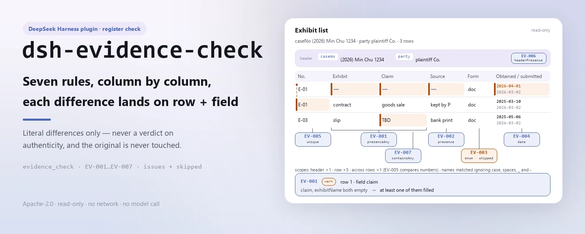

<div align="center">

<picture>
  <source media="(prefers-color-scheme: dark)" srcset="docs/assets/dsh-evidence-check-hero-en-dark.webp">
  
</picture>

# dsh-evidence-check

**साक्ष्य-सूची की पूर्णता, स्रोत, तिथियाँ और क्रमांकन पंक्ति-दर-पंक्ति जाँचें — और पाएँ कौन-सी पंक्ति, कौन-सा कॉलम, क्या कम है।**

वकीलों और मुकदमेबाज़ी सहायता टीमों के लिए DeepSeek Harness जाँच प्लगइन: मुकदमे का हेडर और प्रत्येक साक्ष्य की एक पंक्ति भीतर जाती है, शब्दशः उद्धरण वाला नियम-पैक चलता है, और बाहर वह अंतर-सूची आती है जो सामग्री स्वयं बता सकती है — मूल फ़ाइल को छुए बिना, कोई निर्णय सुनाए बिना।

[इंस्टॉल](#तीन-चरणों-में-शुरुआत) · [कॉन्फ़िगरेशन](#कॉन्फ़िगरेशन) · [FAQ](#faq) · [简体中文](README.md) · [English](README.en.md) · [Español](README.es.md) · [Português](README.pt.md) · [हिन्दी](README.hi.md)

[](LICENSE)
[](#संगतता)
[](https://www.npmjs.com/package/dsh-evidence-check)
[](https://github.com/PerryLink/dsh-evidence-check/actions/workflows/ci.yml)
[](#संगतता)

[](https://github.com/PerryLink/dsh-evidence-check/stargazers)
[](https://www.npmjs.com/package/dsh-evidence-check)
[](https://dshfind.com/plugins/PerryLink/dsh-evidence-check?ref=badge)
[](https://securityscorecards.dev/viewer/?uri=github.com/PerryLink/dsh-evidence-check)
[](https://dsh.market/)
[](https://gitee.com/perrylink/dsh-evidence-check)

```sh
dsh plugin --profile <name> add dsh-evidence-check
```

</div>

<sub>समुदाय प्लगइन, DeepSeek से संबद्ध नहीं। आधिकारिक रेपो: <https://github.com/PerryLink/dsh-evidence-check> (Gitee एक मिरर है)।</sub>

## यह क्या है

`dsh-evidence-check` एक साक्ष्य-सूची पढ़ता है — मुकदमे का हेडर और प्रत्येक साक्ष्य की एक पंक्ति — और उसी सूची की पूर्णता तथा आंतरिक संगति जाँचता है: क्या प्रत्येक साक्ष्य का नाम और वह तथ्य दर्ज है जिसे सिद्ध करना है (`claim`, `exhibitName`), क्या उसका `source` दर्ज है, क्या उसका `form` आपके द्वारा कॉन्फ़िगर की गई शब्दावली से है, क्या `obtainedAt` पढ़ा जा सकता है और `submittedAt` के बाद का नहीं है, क्या कोई `exhibitNo` दोहराया नहीं गया, क्या हेडर `caseNo` और `party` घोषित करता है, और क्या तथ्य-कॉलम में कोई टेम्पलेट प्लेसहोल्डर शेष नहीं है। यह बताता है कि क्या असंगत है, कहाँ है और क्या सुधारना है; मूल फ़ाइल कभी नहीं बदलता, कोई नेटवर्क अनुरोध नहीं करता और किसी मॉडल को नहीं बुलाता। यह तय नहीं करता कि साक्ष्य असली है, वैध रूप से प्राप्त हुआ है या प्रासंगिक है, कि वह तथ्य सिद्ध करता है, या कि उसे स्वीकार या अस्वीकार किया जाना चाहिए — वह जिरह के बाद न्यायालय का निर्णय है।

<picture>
  <source media="(prefers-color-scheme: dark)" srcset="docs/assets/dsh-evidence-check-flow-v5-dark.svg">
  
</picture>

## तीन चरणों में शुरुआत

1. **इंस्टॉल करें**:

   ```sh
   dsh plugin --profile <name> add dsh-evidence-check
   ```

   यह जाँच WorkBuddy / Coze में «Documents and Governance Suite» का भी एक भाग है (उपलब्धता उस मार्केटप्लेस के अनुसार)।

2. **न्यूनतम कॉन्फ़िगरेशन** (डिफ़ॉल्ट वैसे ही काम करते हैं):

   ```yaml
   - insert:
       - id: dsh-evidence-check
         name: dsh-evidence-check
   ```

   सभी समायोज्य पैरामीटर `src/config.ts` की Schemastery स्कीमा में हैं और जैसे हैं वैसे काम करते हैं; प्रति-नियम सीमाएँ `rules/` के नियम-पैक में हैं।

3. **जाँचें कि माउंट हुआ**:

   ```sh
   dsh --profile <name> --dump-config | grep 'dsh-evidence-check'
   ```

   फिर साथ दिया नमूना एक बार चलाएँ (लगभग एक मिनट):

   ```sh
   node samples/quickstart/run.mjs
   ```

   ```text
   $ node samples/quickstart/run.mjs
   evidence_check: 1 issue(s) — error 0, warn 1, info 0
   skipped: 1
   ```

   नमूना इनपुट `samples/quickstart/input/` में, अपेक्षित आउटपुट `samples/quickstart/expected/result.json` में और पहली बार चलाने का टर्मिनल स्क्रीनशॉट [`docs/assets/quickstart.png`](docs/assets/quickstart.png) में है।

**अनइंस्टॉल**: `dsh plugin --profile <name> remove dsh-evidence-check` (या प्रोफ़ाइल पैच से वह पंक्ति हटा दें)।

## मुख्य क्षमताएँ

प्लगइन `evidence_check` टूल पंजीकृत करता है: एक साक्ष्य-सूची पढ़ता है (मुकदमे का हेडर और प्रत्येक साक्ष्य की एक पंक्ति), संस्करण-बद्ध नियम-पैक लागू करता है और एक संरचित रिपोर्ट लौटाता है। सामग्री JSON या YAML है; जो जाँच नहीं चल सकी वह कारण के साथ `skipped` में दर्ज होती है।

- **नियम-पैक डेटा है** — सातों जाँचें `rules/evidence-check.yaml` में हैं, इसलिए नियम-समुच्चय बदलने के लिए कोड नहीं छूना पड़ता; पैक लोड के समय सत्यापित होता है, मान लिया नहीं जाता।
- **गंभीरता साक्ष्य के अनुसार** — व्युत्पन्न सिद्धांत (`derived-from-principle`) पर आधारित नियम `warn` तक सीमित रहता है; संस्थागत कॉन्फ़िगरेशन (`institutional-configuration`) पर आधारित `info` तक; किसी को भी `error` नहीं कहा जाता (एक टेस्ट इसकी पुष्टि करता है)।
- **खाली सूची का अर्थ «कुछ गलत नहीं» नहीं** — हर जाँच जो नहीं चल सकती, कारण के साथ `skipped` में स्वयं को दर्ज करती है; `EV-003` फ़ैक्टरी से खाली `values` के साथ आता है, इसलिए वह चुपचाप पास होने के बजाय `skipped` में स्वयं को दर्ज करता है।
- **कोई निर्णायक भाषा नहीं** — रिपोर्ट केवल अंतर गिनाती है और अनुपालन, दायित्व या सत्यता पर कभी निर्णय नहीं देती; एक शब्द-गार्ड रिपोर्ट को हमेशा अपना अस्वीकरण साथ रखने पर बाध्य करता है।
- **कोई गढ़ा उद्धरण नहीं** — हर नियम में `document` / `number` / `clause` / `excerpt` / `kind` / `source` होता है; `excerpt` शब्दशः उद्धरण होना चाहिए, और जब पाठ उपलब्ध न हो तो पैक यह कह देता है, किसी परिभाषा को उद्धरण बताकर प्रस्तुत नहीं करता।

```text
साक्ष्य-सूची (JSON/YAML) ──evidence_check──▶ नियम EV-001…EV-007 ──▶ रिपोर्ट (issues + skipped)
         ▲                                                                      │
         └──────────────────────────── मूल केवल पढ़ने के लिए, कभी नहीं बदलता ────┘
```

### नियम एक नज़र में

| नियम | क्या जाँचता है | गंभीरता | आधार प्रकार |
|---|---|---|---|
| `EV-001` | हर साक्ष्य अपना नाम और तथ्य बताता है | warn | शब्दशः धारा |
| `EV-002` | हर साक्ष्य अपना स्रोत दर्ज करता है | warn | शब्दशः धारा |
| `EV-003` | रूप आपकी शब्दावली से आता है (डिफ़ॉल्ट रूप से बंद) | info | संस्थागत कॉन्फ़िगरेशन |
| `EV-004` | प्राप्ति-तिथि पढ़ी जा सकती है और प्रस्तुति के बाद की नहीं | warn | व्युत्पन्न सिद्धांत |
| `EV-005` | साक्ष्य-क्रमांक सूची में अद्वितीय हैं | warn | व्युत्पन्न सिद्धांत |
| `EV-006` | सूची मुकदमा-क्रमांक और प्रस्तुत करने वाला पक्ष घोषित करती है | warn | व्युत्पन्न सिद्धांत |
| `EV-007` | तथ्य-कॉलम में कोई अन-प्रतिस्थापित प्लेसहोल्डर नहीं | warn | व्युत्पन्न सिद्धांत |

### उदाहरण

ये प्लगइन के वास्तविक प्रवेश-बिंदु हैं; एक बार इंस्टॉल करें और एक चलाएँ। नीचे का आउटपुट प्लगइन के अपने `EV-001` टेस्ट फ़िक्स्चर पर वास्तविक रन है, कोई चित्रण नहीं।

**विस्तृत आउटपुट** — टूल `evidence_check`, इनपुट:

```json
{"rows":[{"证据编号":"证1","待证事实":"","证据名称":""}]}
```

आउटपुट:

```json
{
  "id": "dsh-evidence-check.EV-001.de09b5a6",
  "ruleId": "EV-001",
  "severity": "warn",
  "locator": {
    "field": "claim",
    "row": 1
  },
  "found": "第 1 行 claim、exhibitName 都为空",
  "expected": "claim、exhibitName 至少应填写一项",
  "fix": "补填证据名称与待证事实；本条只核对是否填写，不判断证据是否足以证明"
}
```

*Observed from `tests/fixtures/EV-001/EV-001-unsafe.json (cases.json expects EV-001 count 1); run via lib/index.mjs rules/evidence-check.yaml`*

### यह किन सवालों का जवाब देता है

| आपका सवाल | इसका जवाब |
|---|---|
| हमने न्यायालय द्वारा तय अवधि के भीतर दाखिल किया। क्या यह उपकरण इसकी पुष्टि करेगा? | नहीं। `EV-004` केवल यह देखता है कि सूची में दर्ज दोनों तिथि-कॉलम पढ़े जा सकते हैं और `obtainedAt` `submittedAt` के बाद का नहीं है; यह कोई साक्ष्य-अवधि नहीं निकालता, क्योंकि वह अवधि न्यायालय तय करता है या पक्षकार तय करते हैं, और उसमें विस्तार तथा स्थगन के अपने नियम हैं। इसलिए सूची की तिथियों को दिन-प्रतिदिन पढ़ना समय-पालन पर कोई निष्कर्ष नहीं है। |
| साक्ष्य का नाम भरा है, पर तथ्य-कॉलम खाली है। | `EV-001` `claim` और `exhibitName` दोनों को साथ लेता है और केवल इतना चाहता है कि इनमें से कम से कम एक भरा हो; दोनों कोठरियाँ खाली होने पर वह पंक्ति दर्ज करता है, और यह नहीं आँकता कि वह साक्ष्य उस तथ्य को सिद्ध करने के लिए पर्याप्त है। |
| दो पंक्तियों में एक ही साक्ष्य-क्रमांक दर्ज है। | `EV-005` सूची के भीतर `exhibitNo` के मानों की तुलना करता है, रिक्त स्थान को छोड़कर, और बाद वाली पंक्ति के साथ वह पंक्ति दर्ज करता है जिसकी वह पुनरावृत्ति है। यह केवल यह स्थापित करता है कि क्रमांक अद्वितीय नहीं है — यह दोहरा पंजीकरण है या क्रमांक की प्रतिलिपि में चूक, यह आपको तय करना है। खाली क्रमांक वाली कोठरी इस तुलना में नहीं आती। |
| इस साक्ष्य का स्रोत स्पष्ट है, फिर भी नियम दर्ज हो रहा है। | क्योंकि स्रोत की कोठरी भरी नहीं है। `EV-002` हर उस साक्ष्य पर `source` की अपेक्षा करता है जिसे सूची यह कॉलम देती है; यह देखता है कि कोठरी में कुछ है, यह नहीं कि स्रोत वैध है या उसे प्राप्त करने का तरीका उचित था। |
| हमारी सूची के हेडर में न मुकदमा-क्रमांक है न दाखिल करने वाला पक्ष। | `EV-006` हेडर पढ़ता है और बताता है कि सामग्री `caseNo` और `party` में से क्या घोषित नहीं करती। यह घोषणा की जाँच करता है, यह नहीं कि घोषित मान सही है, और अनुपस्थित घोषणा हेडर के लिए एक ही बार दर्ज होती है, पंक्ति-दर-पंक्ति नहीं। |
| कौन-सा नियम `skipped` दर्ज करता है, और क्यों? | फ़ैक्टरी स्थिति में `EV-003`: उसके `values` खाली आते हैं, अर्थात् साक्ष्य-रूप की शब्दावली कॉन्फ़िगर नहीं है, और यह प्लगइन साक्ष्य की श्रेणियों की कोई सूची कठोर-कोडित नहीं करता, क्योंकि दीवानी, प्रशासनिक और आपराधिक प्रक्रियाएँ एक जैसी श्रेणियाँ नहीं गिनातीं। अपनी प्रक्रिया की श्रेणियाँ `values` में भरें तो यह नियम चलने लगता है; तब यह केवल देखता है कि प्रत्येक `form` कोठरी उन्हीं में से है, यह नहीं कि कोई साक्ष्य वास्तव में किस श्रेणी का है। |

## कॉन्फ़िगरेशन

सभी समायोज्य पैरामीटर `src/config.ts` की Schemastery स्कीमा में हैं, इसलिए कोड बदले बिना `cordis.yml` से बदले जा सकते हैं; प्रति-नियम सीमाएँ `rules/` के नियम-पैक में हैं। कॉन्फ़िगरेशन की ठीक पाँच कुंजियाँ हैं, नीचे की तालिका में; नियम-स्तरीय पैरामीटर उसके बाद हैं।

| कुंजी | प्रकार | डिफ़ॉल्ट | विवरण |
|---|---|---|---|
| `rulesFile` | string | `rules/evidence-check.yaml` | नियम-पैक का पथ, पैकेज रूट के सापेक्ष |
| `disabledRules` | string[] | `[]` | बंद करने वाले नियम id; प्रत्येक `skipped` में दिखता है |
| `onlyRules` | string[] | `[]` | केवल ये नियम चलाएँ; खाली होने पर सभी नियम चलते हैं |
| `skipNotes` | string | `""` | हर `skipped` कारण के आगे जोड़ी जाने वाली टिप्पणी |
| `timeoutMs` | number | `120000` | उपकरण का सहकारी समय-सीमा बजट |

जानने योग्य नियम-स्तरीय पैरामीटर:

- `EV-003` `values` — आपकी प्रक्रिया की साक्ष्य-श्रेणियाँ; खाली होने पर नियम नहीं चलता और `skipped` में दिखता है। दीवानी प्रक्रिया का उदाहरण:

  ```yaml
  values: [书证, 物证, 视听资料, 电子数据, 证人证言, 鉴定意见, 勘验笔录]
  ```

- `EV-004` `field` / `notAfterField` — तिथि-युग्म, डिफ़ॉल्ट रूप से प्राप्ति बनाम प्रस्तुति; एक ही दिन को «बाद का नहीं» माना जाता है।
- `EV-007` `terms` — खोजे जाने वाले प्लेसहोल्डर:

  ```
  terms: ['【', '】', '{{', '}}', 'XXX', '待填', 'TBD']
  ```

## FAQ

<details>
<summary>क्या मेरी सामग्री बदलेगी या अपलोड होगी?</summary>

नहीं। उपकरण केवल आपके द्वारा दिया गया JSON/YAML पाठ पढ़ता है और **मूल फ़ाइल कभी नहीं बदलता**; प्लगइन शुद्ध ESM है, कोई नेटिव कोड नहीं, **कोई नेटवर्क नहीं और कोई मॉडल कॉल नहीं** (देखें «संगतता»), इसलिए सामग्री आपकी मशीन से बाहर नहीं जाती।

</details>

<details>
<summary>साक्ष्य-रूप की शब्दावली कॉन्फ़िगर न हो तो क्या चुपचाप पास हो जाएगा?</summary>

नहीं। `EV-003` फ़ैक्टरी से खाली `values` के साथ आता है, इसलिए नियम कारण के साथ स्वयं को `skipped` में दर्ज करता है: खाली अंतर-सूची को «कुछ कम नहीं» नहीं पढ़ा जा सकता। अपनी प्रक्रिया की श्रेणियाँ `values` में भरें और नियम चलने लगता है; तब यह केवल देखता है कि प्रत्येक `form` कोठरी उन्हीं में से है, यह नहीं कि कोई साक्ष्य वास्तव में किस श्रेणी का है।

</details>

<details>
<summary>प्लगइन इंस्टॉल हो गया पर टूल दिखता नहीं। क्या करें?</summary>

जाँचें कि `main` `lib/index.mjs` पर जाता है और `pnpm run build` ने उसे बनाया है; गलत `main` लोडर को प्रविष्टि चुपचाप छोड़ने पर मजबूर करता है।

</details>

<details>
<summary>इंस्टॉल पर पैकेज असंगत बताया जाता है। क्या करें?</summary>

peer रेंज `0.1.x` और `0.2.x` दोनों को कवर करती है; यदि आपका runtime उसके बाहर है तो स्पष्ट छूट दें: `dsh plugin --profile <name> allow-version dsh-evidence-check@0.1.0 --dsh-version <runtime> --accept-risk`। इंस्टॉल के समय peer अनुकूलता runtime लागू करता है।

</details>

<details>
<summary>पूरी सूची या पूरा फ़ोल्डर एक बार में जाँचा जा सकता है?</summary>

टूल `native` और `ptc` दोनों मोड में काम करता है; बड़े दस्तावेज़-समुच्चय के लिए `ptc` चुनें, जिससे schema की लागत एक ही बार चुकाई जाए। सारी गणना दिए गए स्ट्रिंग पर वॉल-क्लॉक है, कोई समय-क्षेत्र रूपांतरण नहीं।

</details>

## जिन मानकों का पालन

| दस्तावेज़ | संख्यांक | इन्हें उद्धृत करने वाले नियम |
|---|---|---|
| सर्वोच्च जनता अदालत के दीवानी साक्ष्य कार्यवाही संबंधी प्रावधान | Fa Shi [2019] No. 19 (संस्करण और धारा-क्रमांकन के सत्यापन की स्थिति प्रति-नियम भिन्न है — हर नियम का `number` फ़ील्ड देखें) | EV-001, EV-002, EV-004, EV-005, EV-006, EV-007 |
| सर्वोच्च जनता अदालत के दीवानी साक्ष्य कार्यवाही संबंधी प्रावधान | Fa Shi [2019] No. 19 (1 मई 2020 से प्रभावी) | EV-003 |

**सीमा:** यह प्लगइन एक **साक्ष्य-सूची** को उतने ही पर जाँचता है जितना एक सूची से यांत्रिक रूप से अपेक्षित हो सकता है — कि हर साक्ष्य अपना नाम और वह तथ्य बताए जिसे सिद्ध करना है, कि उसका स्रोत दर्ज हो, कि उसका रूप आपकी शब्दावली से हो, कि प्राप्ति प्रस्तुति से पहले हो, कि साक्ष्य-क्रमांक अद्वितीय हों, कि सूची अपना मुकदमा और प्रस्तुत करने वाला पक्ष बताए, और कि कोई प्लेसहोल्डर शेष न हो। यह **नहीं** तय करता कि साक्ष्य असली है, वैध रूप से प्राप्त हुआ है या प्रासंगिक है, कि वह तथ्य सिद्ध करता है, या कि उसे स्वीकार या अस्वीकार किया जाना चाहिए। **वह जिरह के बाद न्यायालय का निर्णय है, और मुकदमे का केंद्र है।**

> ### ⚠️ रिपोर्ट के किसी उद्धरण पर भरोसा करने से पहले यह पढ़ें
>
> **`excerpt` की स्थिति प्रति-नियम है, एक-सी नहीं।** कुछ नियम धारा को शब्दशः उद्धृत करते हैं (`kind: direct`), कुछ उद्धृत अनुच्छेदों के सिद्धांत से व्युत्पन्न हैं (`kind: derived-from-principle`, अधिकतम `warn`), और कुछ आपकी संस्था द्वारा कॉन्फ़िगर की गई सीमाएँ प्रयोग करते हैं (`kind: institutional-configuration`, अधिकतम `info`)। पैक कभी उद्धरण का पैराफ़्रेज़ नहीं करता: जब पाठ उपलब्ध नहीं हुआ, तो `excerpt` फ़ील्ड यह कह देता है और तर्क `note` में रहता है; एक टेस्ट पुष्टि करता है कि कोई नियम ऐसा उद्धरण नहीं माँगता जो उसके पास नहीं है। **जो भी नियम अभी «पाठ प्राप्त नहीं» के रूप में चिह्नित है, पाठ मिलने पर उसका `excerpt` वास्तविक धारा से बदलें और `kind` को `direct` कर दें।**
>
> निर्णय समीक्षक का है: यह प्लगइन केवल वे अंतर गिनाता है जिन्हें सामग्री में इंगित किया जा सकता है, और तथ्य या अनुपालन पर निर्णय नहीं देता।

## सामग्री प्रारूप

टूल JSON या YAML स्वीकार करता है:

```yaml
caseNo: （2026）某民初 1234 号
caseName: 买卖合同纠纷
party: 原告某某公司
rows:
  - { 证据编号: 证1, 待证事实: 双方于 2025 年 3 月 10 日签订买卖合同,
      证据名称: 买卖合同原件, 证据形式: 书证, 来源: 原告留存，签订时取得,
      页码: 第 1-3 页, 原件: 原件, 取得日期: 2025-03-10, 提交日期: 2026-03-02 }
```

कॉलम-नाम बड़े/छोटे अक्षरों के भेद के बिना और रिक्त स्थान, अंडरस्कोर तथा हाइफ़न छोड़कर मिलाए जाते हैं; सूची के अपने कॉलम-नाम बने रहते हैं, इसलिए हर निष्कर्ष उसी कॉलम का नाम लेता है जिसे उसने पढ़ा। तिथियाँ `2026-03-02` या `2026-03-02 09:30` हो सकती हैं। पढ़ने की परत में फ़ील्ड वैकल्पिक हैं और जाँच इंजन उन्हें सत्यापित करता है, इसलिए आंशिक निर्यात पर क्रैश के बजाय «अनुपस्थित» श्रेणी के निष्कर्ष मिलते हैं।

## नियमों के स्रोत

नियम-डेटा `rules/evidence-check.yaml` में, कोड से अलग है। हर नियम में दस्तावेज़, उसका संख्यांक, स्रोत की अपनी क्रमांकन-प्रणाली के अनुसार धारा, शब्दशः `excerpt`, स्रोत URL और आधार-प्रकार (`kind`) होता है। लोडर लागू करता है कि `excerpt` कम से कम आठ अक्षरों का वास्तविक उद्धरण हो, और केवल व्युत्पन्न सिद्धांत (`derived-from-principle`, गंभीरता अधिकतम `warn`) या संस्थागत कॉन्फ़िगरेशन (`institutional-configuration`, अधिकतम `info`) पर आधारित जाँच को कभी `error` न कहा जाए। अपने आधार को बढ़ा-चढ़ाकर बताने वाला पैक लोड पर विफल होता है, आत्मविश्वासी दिखने वाली रिपोर्ट नहीं बनाता।

`check:citations` गेट और माँग करता है कि हर excerpt खंड `rules/evidence/` के धारा-सत्यापन रिकॉर्ड में शब्दशः मिले; `rules/citations-baseline.json` उन खंडों को दर्ज करता है जो अभी ट्रेस-योग्य नहीं हैं, और वह आधार केवल घट सकता है।

उद्धृत धाराएँ सर्वोच्च जनता अदालत के दीवानी साक्ष्य कार्यवाही संबंधी प्रावधानों (Fa Shi [2019] No. 19) से हैं: अनुच्छेद 1, 11, 14 और 19, तथा अनुच्छेद 50 से 57 में से सूची से संबंधित अनुच्छेद। सत्यापन के दौरान पुष्ट सीमाएँ और जान-बूझकर **न** निकाले गए निष्कर्ष `rules/evidence/` में दर्ज हैं।

## संगतता

| सतह | स्थिति |
|---|---|
| Harness | peer रेंज `>=0.1.2-rc.1 <0.2.0 \|\| >=0.2.0-0 <0.3.0` — `0.2.0-rc.2` और `0.2.1-rc.2` दोनों को स्वीकार करने के लिए सत्यापित। `engines.dsh` `>=0.2.1-0 <0.3.0` के रूप में घोषित है और 0.2.1 से होस्ट इसे लागू करता है |
| Node | `^22.19.0 \|\| >=24.0.0` |
| प्लेटफ़ॉर्म | सभी (शुद्ध ESM; कोई नेटिव कोड नहीं, कोई नेटवर्क नहीं, कोई मॉडल कॉल नहीं) |
| टूल मोड | `native` और `ptc` में काम करता है; बड़े दस्तावेज़-समुच्चय के लिए `ptc` चुनें, जिससे schema की लागत एक ही बार चुकाई जाए |

## समस्या निवारण

- **`EV-003` कभी नहीं चलता।** उसकी शब्दावली खाली है। दीवानी, प्रशासनिक और आपराधिक प्रक्रियाओं में साक्ष्य की श्रेणियाँ भिन्न हैं, इसलिए प्लगइन कोई सूची नहीं थोपता; अपनी प्रक्रिया के `values` नियम-पैक में भरें।
- **`EV-004` उस सामग्री पर भी दर्ज होता है जो अवधि के भीतर दाखिल हुई।** नियम अवधि नहीं जानता; वह केवल सूची की दोनों तिथि-कोठरियों की तुलना करता है। यदि प्राप्ति वास्तव में प्रस्तुति के बाद है, तो दोनों में से एक गलत है।
- **`EV-002` उस साक्ष्य पर भी दर्ज होता है जिसका स्रोत स्पष्ट है।** खाली स्रोत-कोठरी का अर्थ है कि सूची यह नहीं बताती कि साक्ष्य कहाँ से आया — और यही तो सूची को बताना होता है।
- **`EV-005` एक ही साक्ष्य-क्रमांक पर दो बार दर्ज होता है।** पूरक संग्रह को उसी क्रमांक से नंबर देना सामान्य है; टिप्पणी पर निर्भर रहने के बजाय क्रमांक सुधारें।
- **प्लगइन इंस्टॉल हो गया पर टूल दिखता नहीं।** जाँचें कि `main` `lib/index.mjs` पर जाता है और `pnpm run build` ने उसे बनाया है; गलत `main` लोडर को प्रविष्टि चुपचाप छोड़ने पर मजबूर करता है।
- **`dsh plugin add` पैकेज को असंगत बताकर मना करता है।** peer रेंज `0.1.x` और `0.2.x` दोनों को कवर करती है; यदि आपका runtime उसके बाहर है तो स्पष्ट छूट दें: `dsh plugin --profile <name> allow-version dsh-evidence-check@0.1.0 --dsh-version <runtime> --accept-risk`
- **कोई नियम नहीं चला।** `skipped` सरणी देखें; वह नियम id और कारण बताती है।
- **`check` में `manifest-peers` विफल दिखता है।** स्थिर जाँचकर्ता 0.2 पंक्ति से पहले के कठोर-कोडित peer रेंज से तुलना करता है; इंस्टॉल के समय peer अनुकूलता runtime लागू करता है। यह `dsh-plugin-dev` की ज्ञात अपस्ट्रीम समस्या है।
- **समय खिसका हुआ लगता है।** सारी गणना दिए गए स्ट्रिंग पर वॉल-क्लॉक है, कोई समय-क्षेत्र रूपांतरण नहीं।

## इकोसिस्टम और गुणवत्ता

- [Gitee मिरर](https://gitee.com/perrylink/dsh-evidence-check) (समन्वित मिरर; GitHub आधिकारिक है)
- [dshfind प्लगइन पृष्ठ](https://dshfind.com/plugins/PerryLink/dsh-evidence-check) (इंस्टॉल और रैंकिंग)
- [OpenSSF Scorecard रिपोर्ट](https://securityscorecards.dev/viewer/?uri=github.com/PerryLink/dsh-evidence-check) ([.github/workflows/scorecard.yml](.github/workflows/scorecard.yml) द्वारा संचालित)
- [DSH Market](https://dsh.market/) (सूचीबद्ध)
- [इकोसिस्टम ज्ञान-आधार · सामग्री के अनुसार जाँचक चुनें](https://perrylink.github.io/zh/checkers/choose/) (पूरा परिवार: जाँचक और सामान्य प्लगइन)

## डेवलपमेंट

```sh
pnpm install
pnpm run typecheck   # tsc --noEmit
pnpm test            # vitest; हर नियम के paired fixtures tests/fixtures/<RULE>/ में
pnpm run build       # tsdown -> lib/index.mjs + lib/index.d.mts
pnpm run check:readmes   # पाँच-भाषा README स्थिरता
node ../scripts/sync-shared.mjs dsh-evidence-check   # ../_shared से src/shared ताज़ा करें
```

प्लगइन **केवल-डेटा** है: `src/model.ts` तालिका का आकार घोषित करता है, साझा किट पढ़ने वाला और जाँच-इंजन देता है, और नियम-पैक हर जाँच घोषित करता है। नियम-पैक डेटा है, कोड नहीं: `rules/*.yaml` बदलने से TypeScript छुए बिना नियम-समुच्चय बदल जाता है, और पैक लोड पर सत्यापित होता है, मान लिया नहीं जाता। README की छवियाँ [`scripts/gen-readme-assets.py`](scripts/gen-readme-assets.py) (Python + Pillow) से प्रोग्रामेटिक रूप से बनती हैं और दोबारा चलाई जा सकती हैं; इस प्लगइन में कोई UI नहीं है, इसलिए hero हाथ से लिखा SVG प्रवाह-चित्र है (हल्का और गहरा, केवल कमांड-सतह के टोकन)।

विषय: `dsh`, `dsh-plugin`, `deepseek-harness`, `cordis`, `evidence`

## परिवार और आभार

यह परियोजना [PerryLink](https://github.com/PerryLink) के DeepSeek Harness प्लगइन परिवार का हिस्सा है (सभी Apache-2.0)। अगर यह उपयोगी हो, तो **एक स्टार अगले व्यक्ति को इसे खोजने में मदद करता है** — इसके पीछे कुछ भी बंद नहीं है।

- [@PerryLink](https://github.com/PerryLink) — निर्माता और अनुरक्षक: `evidence_check` टूल, शब्दशः उद्धरण वाला नियम-पैक और उसका धारा-सत्यापन रिकॉर्ड, तथा पाँच-भाषा दस्तावेज़।

<details>
<summary>सभी प्लगइन देखें</summary>

| प्लगइन | स्थिति |
|---|---|
| **[dsh-aqua-input-check](https://github.com/PerryLink/dsh-aqua-input-check)** |  |
| **[dsh-archive-check](https://github.com/PerryLink/dsh-archive-check)** |  |
| **[dsh-auto-review](https://github.com/PerryLink/dsh-auto-review)** |  |
| **[dsh-autotier](https://github.com/PerryLink/dsh-autotier)** | 🧊 फ़्रोज़न — रेपो README देखें |
| **[dsh-bid-ca-precheck](https://github.com/PerryLink/dsh-bid-ca-precheck)** |  |
| **[dsh-bid-qual-check](https://github.com/PerryLink/dsh-bid-qual-check)** |  |
| **[dsh-cert-mcp](https://github.com/PerryLink/dsh-cert-mcp)** | 🧊 फ़्रोज़न — रेपो README देखें |
| **[dsh-checkpoint-rewind](https://github.com/PerryLink/dsh-checkpoint-rewind)** |  |
| **[dsh-click](https://github.com/PerryLink/dsh-click)** |  |
| **[dsh-composer-history](https://github.com/PerryLink/dsh-composer-history)** |  |
| **[dsh-contract-stance](https://github.com/PerryLink/dsh-contract-stance)** |  |
| **[dsh-customs-doc-check](https://github.com/PerryLink/dsh-customs-doc-check)** |  |
| **[dsh-data-quality](https://github.com/PerryLink/dsh-data-quality)** | 🧊 फ़्रोज़न — रेपो README देखें |
| **[dsh-demurrage-ledger](https://github.com/PerryLink/dsh-demurrage-ledger)** |  |
| **[dsh-doublecheck](https://github.com/PerryLink/dsh-doublecheck)** |  |
| **[dsh-drill-script-check](https://github.com/PerryLink/dsh-drill-script-check)** |  |
| **[dsh-eia-guide-check](https://github.com/PerryLink/dsh-eia-guide-check)** |  |
| **[dsh-emergency-plan](https://github.com/PerryLink/dsh-emergency-plan)** |  |
| **[dsh-essay-rubric-check](https://github.com/PerryLink/dsh-essay-rubric-check)** |  |
| **[dsh-evidence-check](https://github.com/PerryLink/dsh-evidence-check)** |  |
| **[dsh-export-ctl-check](https://github.com/PerryLink/dsh-export-ctl-check)** |  |
| **[dsh-fast](https://github.com/PerryLink/dsh-fast)** |  |
| **[dsh-fmea-table-check](https://github.com/PerryLink/dsh-fmea-table-check)** |  |
| **[dsh-forecast-penalty](https://github.com/PerryLink/dsh-forecast-penalty)** |  |
| **[dsh-fund-research](https://github.com/PerryLink/dsh-fund-research)** |  |
| **[dsh-github](https://github.com/PerryLink/dsh-github)** |  |
| **[dsh-gongwen-flow-check](https://github.com/PerryLink/dsh-gongwen-flow-check)** |  |
| **[dsh-gongwen-word-check](https://github.com/PerryLink/dsh-gongwen-word-check)** |  |
| **[dsh-guard-plan-qc](https://github.com/PerryLink/dsh-guard-plan-qc)** |  |
| **[dsh-hazchem-check](https://github.com/PerryLink/dsh-hazchem-check)** |  |
| **[dsh-hazplan-check](https://github.com/PerryLink/dsh-hazplan-check)** |  |
| **[dsh-hidden-risk-map](https://github.com/PerryLink/dsh-hidden-risk-map)** |  |
| **[dsh-hs-classify](https://github.com/PerryLink/dsh-hs-classify)** |  |
| **[dsh-icd-rule-check](https://github.com/PerryLink/dsh-icd-rule-check)** |  |
| **[dsh-industry-research](https://github.com/PerryLink/dsh-industry-research)** |  |
| **[dsh-lawcite-adapter](https://github.com/PerryLink/dsh-lawcite-adapter)** |  |
| **[dsh-laya](https://github.com/PerryLink/dsh-laya)** |  |
| **[dsh-lc-doc-check](https://github.com/PerryLink/dsh-lc-doc-check)** |  |
| **[dsh-learning-gap-check](https://github.com/PerryLink/dsh-learning-gap-check)** |  |
| **[dsh-library](https://github.com/PerryLink/dsh-library)** |  |
| **[dsh-local-ai](https://github.com/PerryLink/dsh-local-ai)** |  |
| **[dsh-lsp-actions](https://github.com/PerryLink/dsh-lsp-actions)** |  |
| **[dsh-mask](https://github.com/PerryLink/dsh-mask)** |  |
| **[dsh-mcp-panel](https://github.com/PerryLink/dsh-mcp-panel)** |  |
| **[dsh-medrec-qc](https://github.com/PerryLink/dsh-medrec-qc)** |  |
| **[dsh-memento](https://github.com/PerryLink/dsh-memento)** | 🧊 फ़्रोज़न — रेपो README देखें |
| **[dsh-nsfc-form-check](https://github.com/PerryLink/dsh-nsfc-form-check)** |  |
| **[dsh-nurse-record-check](https://github.com/PerryLink/dsh-nurse-record-check)** |  |
| **[dsh-observe](https://github.com/PerryLink/dsh-observe)** |  |
| **[dsh-origin-rvc-check](https://github.com/PerryLink/dsh-origin-rvc-check)** |  |
| **[dsh-ota-review-check](https://github.com/PerryLink/dsh-ota-review-check)** |  |
| **[dsh-output-styles](https://github.com/PerryLink/dsh-output-styles)** |  |
| **[dsh-paper-doc-adapter](https://github.com/PerryLink/dsh-paper-doc-adapter)** |  |
| **[dsh-permission-rules](https://github.com/PerryLink/dsh-permission-rules)** |  |
| **[dsh-permit-report-check](https://github.com/PerryLink/dsh-permit-report-check)** |  |
| **[dsh-pipeline-check](https://github.com/PerryLink/dsh-pipeline-check)** |  |
| **[dsh-pleading-draft](https://github.com/PerryLink/dsh-pleading-draft)** |  |
| **[dsh-plugin-doctor](https://github.com/PerryLink/dsh-plugin-doctor)** | 🚫 रिटायर्ड (रेपो संग्रहीत) |
| **[dsh-plugin-guide](https://github.com/PerryLink/dsh-plugin-guide)** |  |
| **[dsh-plugin-kit](https://github.com/PerryLink/dsh-plugin-kit)** | 🚫 रिटायर्ड (रेपो संग्रहीत) |
| **[dsh-plugin-upgrade](https://github.com/PerryLink/dsh-plugin-upgrade)** | 🚫 रिटायर्ड (रेपो संग्रहीत) |
| **[dsh-policy-brief-draft](https://github.com/PerryLink/dsh-policy-brief-draft)** |  |
| **[dsh-power-loss-split](https://github.com/PerryLink/dsh-power-loss-split)** |  |
| **[dsh-power-ticket-check](https://github.com/PerryLink/dsh-power-ticket-check)** |  |
| **[dsh-ppap-check](https://github.com/PerryLink/dsh-ppap-check)** |  |
| **[dsh-protest-deadline](https://github.com/PerryLink/dsh-protest-deadline)** |  |
| **[dsh-railway-window](https://github.com/PerryLink/dsh-railway-window)** |  |
| **[dsh-repair-order-qc](https://github.com/PerryLink/dsh-repair-order-qc)** |  |
| **[dsh-research-report](https://github.com/PerryLink/dsh-research-report)** |  |
| **[dsh-review-reply-check](https://github.com/PerryLink/dsh-review-reply-check)** |  |
| **[dsh-rulefile-check](https://github.com/PerryLink/dsh-rulefile-check)** |  |
| **[dsh-safety-brief-check](https://github.com/PerryLink/dsh-safety-brief-check)** |  |
| **[dsh-score](https://github.com/PerryLink/dsh-score)** | 🧊 फ़्रोज़न — रेपो README देखें |
| **[dsh-session-sync](https://github.com/PerryLink/dsh-session-sync)** |  |
| **[dsh-site-log-check](https://github.com/PerryLink/dsh-site-log-check)** |  |
| **[dsh-skill-pack-security](https://github.com/PerryLink/dsh-skill-pack-security)** |  |
| **[dsh-soe-decision-check](https://github.com/PerryLink/dsh-soe-decision-check)** |  |
| **[dsh-soilwater-check](https://github.com/PerryLink/dsh-soilwater-check)** |  |
| **[dsh-sop-sync-check](https://github.com/PerryLink/dsh-sop-sync-check)** |  |
| **[dsh-spc-gbt-adapter](https://github.com/PerryLink/dsh-spc-gbt-adapter)** |  |
| **[dsh-talk](https://github.com/PerryLink/dsh-talk)** |  |
| **[dsh-tender-extract](https://github.com/PerryLink/dsh-tender-extract)** |  |
| **[dsh-tender-matrix](https://github.com/PerryLink/dsh-tender-matrix)** |  |
| **[dsh-test-drive](https://github.com/PerryLink/dsh-test-drive)** |  |
| **[dsh-ticktick](https://github.com/PerryLink/dsh-ticktick)** | 🚫 रिटायर्ड (रेपो संग्रहीत) |
| **[dsh-translate](https://github.com/PerryLink/dsh-translate)** |  |
| **[dsh-warranty-calc](https://github.com/PerryLink/dsh-warranty-calc)** |  |
| **[dsh-budget](https://github.com/PerryLink/dsh-budget)** | 🧊 फ़्रोज़न — रेपो README देखें |
| **[dsh-claude-move](https://github.com/PerryLink/dsh-claude-move)** | 🧊 फ़्रोज़न — रेपो README देखें |
| **[dsh-defend](https://github.com/PerryLink/dsh-defend)** | 🧊 फ़्रोज़न — रेपो README देखें |
| **[dsh-draw](https://github.com/PerryLink/dsh-draw)** | 🧊 फ़्रोज़न — रेपो README देखें |
| **[dsh-reach](https://github.com/PerryLink/dsh-reach)** | 🧊 फ़्रोज़न — रेपो README देखें |
| **[dsh-background-agents](https://github.com/PerryLink/dsh-background-agents)** | 🚫 रिटायर्ड (रेपो संग्रहीत) |
| **[dsh-session-pin](https://github.com/PerryLink/dsh-session-pin)** | 🚫 रिटायर्ड (रेपो संग्रहीत) |
| **[dsh-team-rooms](https://github.com/PerryLink/dsh-team-rooms)** | 🚫 रिटायर्ड (रेपो संग्रहीत) |

</details>

## लाइसेंस

[LICENSE](LICENSE) (Apache License 2.0) © 2026 dsh-evidence-check contributors

<p align="center"><sub>Apache-2.0 · समुदाय प्लगइन, DeepSeek से असंबद्ध।</sub></p>
