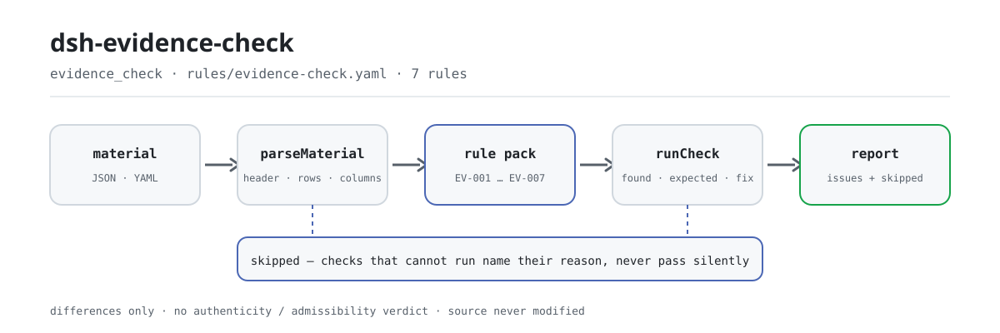

<div align="center">

<picture>
  <source media="(prefers-color-scheme: dark)" srcset="docs/assets/dsh-evidence-check-flow-dark.svg">
  
</picture>

# dsh-evidence-check

**逐行核对证据清单的齐备、来源、日期与编号——输出「哪一行、哪一栏、差什么」的清单。**

面向律师与诉讼辅助人员的 DeepSeek Harness 检查插件：案件表头加每份证据一行，套用逐条引文的规则包，只列材料内部可以逐条指认的差异，不改原件、不下结论。

[安装](#三步上手) · [配置](#配置) · [FAQ](#faq) · [简体中文](README.md) · [English](README.en.md) · [Español](README.es.md) · [Português](README.pt.md) · [हिन्दी](README.hi.md)

[](LICENSE)
[](#兼容性)
[](https://www.npmjs.com/package/dsh-evidence-check)
[](https://github.com/PerryLink/dsh-evidence-check/actions/workflows/ci.yml)
[](#兼容性)

[](https://github.com/PerryLink/dsh-evidence-check/stargazers)
[](https://www.npmjs.com/package/dsh-evidence-check)
[](https://dshfind.com/plugins/PerryLink/dsh-evidence-check?ref=badge)
[](https://securityscorecards.dev/viewer/?uri=github.com/PerryLink/dsh-evidence-check)
[](https://dsh.market/)
[](https://gitee.com/perrylink/dsh-evidence-check)

```sh
dsh plugin --profile <name> add dsh-evidence-check
```

</div>

<sub>社区插件，与 DeepSeek 官方无关。唯一仓库：<https://github.com/PerryLink/dsh-evidence-check>（Gitee 为镜像）。</sub>

## 它是什么

`dsh-evidence-check` 读取一份证据清单——案件表头加上每份证据一行——核对这份清单自身的齐备与自洽：每份证据是否写明名称与待证事实（`claim`、`exhibitName`）、是否注明来源（`source`）、证据形式（`form`）是否属于你所配置的取值口径、取得日期（`obtainedAt`）是否可解析且不晚于提交日期（`submittedAt`）、证据编号（`exhibitNo`）是否唯一、表头是否声明案号（`caseNo`）与举证方（`party`），以及待证事实栏是否残留模板占位符。它返回一份「哪一行、哪一栏、差什么」的差异清单，不改原件、不联网、不调用模型；不判断证据是否真实、取得是否合法、是否具有关联性，是否足以证明待证事实，是否应予采信或排除——那是法庭经质证后依法作出的判断。

## 三步上手

1. **安装**：

   ```sh
   dsh plugin --profile <name> add dsh-evidence-check
   ```

   也可以在 WorkBuddy / 扣子搜「文书与治理核对包」（本检查是其中一项；上架以商城为准）。

2. **最小配置**（默认即可用）：

   ```yaml
   - insert:
       - id: dsh-evidence-check
         name: dsh-evidence-check
   ```

   全部可调项都在 `src/config.ts` 的 Schemastery schema 里，默认值开箱即用；逐条阈值在 `rules/` 下的规则包里。

3. **验证已生效**：

   ```sh
   dsh --profile <name> --dump-config | grep 'dsh-evidence-check'
   ```

   再用自带样例跑一次（约 1 分钟）：

   ```sh
   node samples/quickstart/run.mjs
   ```

   ```text
   $ node samples/quickstart/run.mjs
   evidence_check: 1 issue(s) — error 0, warn 1, info 0
   skipped: 1
   ```

   样例输入在 `samples/quickstart/input/`，期望输出在 `samples/quickstart/expected/result.json`，首次运行的终端截图见 [`docs/assets/quickstart.png`](docs/assets/quickstart.png)。

**卸载**：`dsh plugin --profile <name> remove dsh-evidence-check`（或从 profile patch 删掉该行）。

## 核心能力

本插件注册 `evidence_check` 工具：读入一份证据清单（案件表头加每份证据一行），套用带版本的规则包，返回一份结构化报告。材料为 JSON 或 YAML；无法执行的检查会列在 `skipped` 中，并写明原因。

- **规则包即数据** —— 7 条检查全部在 `rules/evidence-check.yaml` 里，换规则不动代码；规则包在加载期校验，而非被信任。
- **严重级跟着依据走** —— 依据为原则性条款（`derived-from-principle`）的规则封顶 `warn`，依据为本机构配置（`institutional-configuration`）的封顶 `info`；绝不会把原则或本地配置标成 `error`（有测试断言）。
- **空清单不等于没问题** —— 每一项无法执行的检查都会在 `skipped` 里自报原因；`EV-003` 的 `values` 出厂为空，因此它自报 `skipped`，而不是静默通过。
- **不裁决** —— 报告只列差异，永不判定合规、责任或对错；措辞守卫强制报告始终携带免责声明。
- **引文不伪造** —— 每条规则带 `document` / `number` / `clause` / `excerpt` / `kind` / `source`；`excerpt` 必须是逐字引文，取不到就明说，绝不把转述包装成引文。

```text
证据清单（JSON/YAML）──evidence_check──▶ 规则包 EV-001…EV-007 ──▶ 报告（issues + skipped）
         ▲                                                                        │
         └──────────────────────────── 原件只读，永不修改 ─────────────────────────┘
```

### 规则一览

| 规则 | 核对内容 | 严重级 | 依据类型 |
|---|---|---|---|
| `EV-001` | 每份证据写明名称与待证事实 | warn | 逐字条文 |
| `EV-002` | 每份证据注明来源 | warn | 逐字条文 |
| `EV-003` | 证据形式取自你配置的取值口径（默认关闭） | info | 本机构配置 |
| `EV-004` | 取得日期可解析，且不晚于提交日期 | warn | 原则性条款 |
| `EV-005` | 证据编号在清单内唯一 | warn | 原则性条款 |
| `EV-006` | 清单声明案号与举证方 | warn | 原则性条款 |
| `EV-007` | 待证事实栏没有未替换的占位符 | warn | 原则性条款 |

### 示例

以下为插件真实入口；安装后调用一次即可。该输出取自插件对自己 `EV-001` 测试夹具的运行结果，不是示意图。

**详细输出** — 工具 `evidence_check`，输入：

```json
{"rows":[{"证据编号":"证1","待证事实":"","证据名称":""}]}
```

输出：

```json
{
  "id": "dsh-evidence-check.EV-001.de09b5a6",
  "ruleId": "EV-001",
  "severity": "warn",
  "locator": {
    "field": "claim",
    "row": 1
  },
  "found": "第 1 行 claim、exhibitName 都为空",
  "expected": "claim、exhibitName 至少应填写一项",
  "fix": "补填证据名称与待证事实；本条只核对是否填写，不判断证据是否足以证明"
}
```

*Observed from `tests/fixtures/EV-001/EV-001-unsafe.json (cases.json expects EV-001 count 1); run via lib/index.mjs rules/evidence-check.yaml`*

### 它回答什么问题

| 你会问 | 它怎么答 |
|---|---|
| 我们在法院指定的期限内提交了，工具能确认这一点吗？ | 不能。`EV-004` 只核对清单自己带着的两栏日期能否解析、`obtainedAt` 是否不晚于 `submittedAt`；它不推算举证期限——该期限由法院指定或当事人协商，另有延长与中止情形。因此逐日核对清单上的日期，并不构成关于是否逾期提交的结论。 |
| 证据名称填了，待证事实栏空着。 | `EV-001` 把 `claim` 与 `exhibitName` 一并核对，只要求两者至少填了一项；两栏都为空才报出该行，它不判断该份证据是否足以证明该事实——那需要经质证后由法庭判断。 |
| 两行填了同一个证据编号。 | `EV-005` 在清单内部比较 `exhibitNo`，比较时忽略空白字符，报出后出现的那一行及其重复的对象。它只确认编号不唯一——究竟属于重复登记还是编号抄错，需你自行确认。编号栏为空的行不参与这项比较。 |
| 这份证据的来源明摆着，为什么还被报出？ | 因为来源栏没有填写。`EV-002` 要求凡清单给了 `source` 这一栏的每份证据都注明来源；它只核对这一栏有没有内容，不判断来源是否合法、取得方式是否正当。 |
| 清单表头没有写案号和举证方。 | `EV-006` 读取表头，报出材料未声明的 `caseNo` 与 `party`；它核对的是有没有声明，不判断声明的值是否正确，且缺声明只在表头报一条，不逐行重复。 |
| 哪一条会报 `skipped`，为什么？ | 出厂状态下是 `EV-003`：它的 `values` 为空，即证据形式取值口径未配置，而本插件不硬编码证据种类清单——民事、行政、刑事程序列举的种类并不一致。把 `values` 填成本程序的口径后本条即开始运行，此后它只核对每个 `form` 的值是否在册，不判断某份证据实际上属于哪一类。 |

## 配置

全部可调参数都在 `src/config.ts` 的 Schemastery schema 中，只改 `cordis.yml` 即可生效，无需改代码；逐条阈值在 `rules/` 下的规则库文件里。全部配置键即下表 5 个；规则级参数见表后。

| 键 | 类型 | 默认值 | 说明 |
|---|---|---|---|
| `rulesFile` | string | `rules/evidence-check.yaml` | 规则库文件路径，相对插件包根目录 |
| `disabledRules` | string[] | `[]` | 要停用的规则 id 列表；每条都会出现在 `skipped` 中 |
| `onlyRules` | string[] | `[]` | 只执行这些规则 id；留空表示执行全部规则 |
| `skipNotes` | string | `""` | 附加到每条 `skipped` 说明后的备注 |
| `timeoutMs` | number | `120000` | 工具协作式超时预算（毫秒） |

值得知道的规则级参数：

- `EV-003` `values` —— 本程序的证据种类，如 `[书证, 物证, 视听资料, 电子数据, 证人证言, 鉴定意见, 勘验笔录]`。留空表示本条不执行，并出现在 `skipped` 中。
- `EV-004` `field` / `notAfterField` —— 日期对，默认「取得日期 / 提交日期」；同一天视为不晚于。
- `EV-007` `terms` —— 要查找的占位符词表，如 `【`、`】`、`{{`、`}}`、`XXX`、`待填`、`TBD`。

## FAQ

<details>
<summary>我的材料会被改动或上传吗？</summary>

不会。工具只读取你交出的 JSON/YAML 材料文本，**绝不修改原件**；插件是纯 ESM、无原生代码、**不联网、不调用模型**（见「兼容性」），材料不离开你的机器。

</details>

<details>
<summary>没配证据形式口径时，会不会静默通过？</summary>

不会。`EV-003` 的 `values` 出厂为空，规则会把自己报进 `skipped` 并写明原因——空的差异清单不会被读成「没有缺项」。把本程序的证据种类填进 `values` 后它才开始运行；此后它只核对每个 `form` 的值是否在册，不判断某份证据实际上属于哪一类。

</details>

<details>
<summary>插件装上了但工具不出现，怎么办？</summary>

确认 `main` 指向 `lib/index.mjs` 且 `pnpm run build` 已生成该文件；`main` 写错会让加载器静默跳过该条目。

</details>

<details>
<summary>安装时被判版本不兼容，怎么办？</summary>

peer 范围覆盖 `0.1.x` 与 `0.2.x`；若你的运行时在其之外，可显式豁免：`dsh plugin --profile <name> allow-version dsh-evidence-check@0.1.0 --dsh-version <runtime> --accept-risk`。安装期的 peer 校验以运行时为准。

</details>

<details>
<summary>一整份清单或整个目录批量核，跑得动吗？</summary>

工具在 `native` 与 `ptc` 两种模式下都可用；批量校验整个目录时建议 `ptc`，schema 成本只付一次。全部计算都是对输入字符串做墙上时钟运算，不做时区换算。

</details>

## 依据的标准

| 文件 | 文号 | 引用它的规则 |
|---|---|---|
| 《最高人民法院关于民事诉讼证据的若干规定》 | 法释〔2019〕19号（现行版本与条号的核对状态逐条不同，以规则文件的 `number` 字段为准） | EV-001, EV-002, EV-004, EV-005, EV-006, EV-007 |
| 《最高人民法院关于民事诉讼证据的若干规定》 | 法释〔2019〕19号（自 2020 年 5 月 1 日起施行） | EV-003 |

**边界：** 本插件核对一份 **证据清单** 在清单层面可以机械要求到的事项——每份证据是否写明名称与待证事实，是否注明来源，证据形式是否取自你配置的取值口径，取得是否先于提交，证据编号是否唯一，清单是否写明案号与举证方，以及是否残留占位符。它**不**判定证据是否真实、取得是否合法、是否具有关联性，也不判定其能否证明待证事实，或是否应当采信或排除。**那是法庭经质证后作出的判断，也是案件的核心。**

> ### ⚠️ 在采信报告中的引文之前，请先读这一段
>
> **每条 `excerpt` 的状态逐条不同，不是统一的。** 有的规则引用逐字条文（`kind: direct`），有的按条文原则推导（`kind: derived-from-principle`，最高 `warn`），有的阈值由本机构配置（`kind: institutional-configuration`，最高 `info`）。规则包从不概括引文：取不到原文时，`excerpt` 会如实写明，推理写在 `note` 里；并有测试断言没有任何规则声称拥有它并不拥有的引文。**对仍标为「未取得原文」的规则，取得文本后必须把 `excerpt` 换成真实条款，并把 `kind` 提升为 `direct`。**
>
> 结论性判断留给审核人：本插件只列出材料内部可以逐条指认的差异，不判断事实真伪，也不评价合规性。

## 材料格式

工具接受 JSON 或 YAML：

```yaml
caseNo: （2026）某民初 1234 号
caseName: 买卖合同纠纷
party: 原告某某公司
rows:
  - { 证据编号: 证1, 待证事实: 双方于 2025 年 3 月 10 日签订买卖合同,
      证据名称: 买卖合同原件, 证据形式: 书证, 来源: 原告留存，签订时取得,
      页码: 第 1-3 页, 原件: 原件, 取得日期: 2025-03-10, 提交日期: 2026-03-02 }
```

栏目名在比对时忽略大小写、空格、下划线与连字符；报告沿用清单自己的栏目名，因此每条发现都会指名它读的那一栏。日期可以写成 `2026-03-02` 或 `2026-03-02 09:30`。字段在读取层是可选的，由检查引擎校验，因此部分导出的材料会产生「缺项」类差异，而不是让程序崩溃。

## 规则来源

规则数据在 `rules/evidence-check.yaml`，与代码分离。每条规则携带文件名、文号、按原文自身编号体系的条款号、逐字摘录（`excerpt`）与来源链接，并标注依据类型（`kind`）。加载期强制：`excerpt` 必须是真实引文且不少于八个字符；依据仅为原则性条款（`derived-from-principle`，严重级上限 `warn`）或本机构配置（`institutional-configuration`，上限 `info`）的检查不得标为 `error`。夸大依据的规则库会在加载期失败，而不会产出一份看起来很有底气的报告。

`check:citations` 门禁进一步要求每段引文都能在 `rules/evidence/` 的条款核验台账里逐字找到；`rules/citations-baseline.json` 记录尚未可追溯的段落，基线只允许缩小、不允许新增。

所引条款来自《最高人民法院关于民事诉讼证据的若干规定》（法释〔2019〕19号）：第一条、第十一条、第十四条、第十九条，以及第五十条至第五十七条中与清单有关的各条。核验中确认的边界与「刻意没有作出的结论」见 `rules/evidence/`。

## 兼容性

| 项目 | 状态 |
|---|---|
| Harness | 对等版本范围 `>=0.1.2-rc.1 <0.2.0 \|\| >=0.2.0-0 <0.3.0` —— 已实测同时接受 `0.2.0-rc.2` 与 `0.2.1-rc.2`。已声明 `engines.dsh`：`>=0.2.1-0 <0.3.0`，0.2.1 起由宿主单独裁决 |
| Node | `^22.19.0 \|\| >=24.0.0` |
| 平台 | 全平台（纯 ESM；无原生代码、无联网、不调用模型） |
| 工具模式 | `native` / `ptc` 均可；批量校验整个目录时建议 `ptc`，schema 成本只付一次 |

## 故障排查

- **`EV-003` 从不执行。** 它的取值口径为空。民事、行政、刑事程序列举的证据种类并不一致，因此插件不替你指定清单；把本程序的 `values` 填进规则包即可。
- **`EV-004` 对期限内提交的材料仍报出。** 该规则不知道举证期限，只比较清单自带的两栏日期；若取得日期确实晚于提交日期，两个日期中必有一个填错。
- **`EV-002` 对来源明摆着的证据也报出。** 来源栏为空，意味清单没有写明该证据从何而来——这正是清单必须写明的内容。
- **`EV-005` 对同一个证据编号报两次。** 补充证据沿用原编号很常见；请改正编号，而不是依赖备注说明。
- **插件装上了但工具不出现。** 确认 `main` 指向 `lib/index.mjs` 且 `pnpm run build` 已生成该文件；`main` 写错会让加载器静默跳过该条目。
- **`dsh plugin add` 以不兼容为由拒绝。** peer 范围覆盖 `0.1.x` 与 `0.2.x`；若运行时在其之外，可显式豁免：`dsh plugin --profile <name> allow-version dsh-evidence-check@0.1.0 --dsh-version <runtime> --accept-risk`
- **某条规则没有执行。** 查看 `skipped` 数组，其中写明了规则 id 与原因。
- **`check` 报 `manifest-peers` 失败。** 静态检查器比对的是一份早于 0.2 世代的硬编码 peer 范围；安装期的 peer 校验以运行时为准。这是 `dsh-plugin-dev` 的已知上游问题。
- **时间看起来偏移。** 全部计算都是对输入字符串做墙上时钟运算，不做时区换算。

## 生态与质量

- [Gitee 镜像](https://gitee.com/perrylink/dsh-evidence-check)（同步镜像，以 GitHub 为准）
- [dshfind 插件页](https://dshfind.com/plugins/PerryLink/dsh-evidence-check)（安装量与排名）
- [OpenSSF Scorecard 报告](https://securityscorecards.dev/viewer/?uri=github.com/PerryLink/dsh-evidence-check)（由 [.github/workflows/scorecard.yml](.github/workflows/scorecard.yml) 驱动）
- [DSH Market](https://dsh.market/)（已上架）
- [生态实测知识库 · 按材料选核查器](https://perrylink.github.io/zh/checkers/choose/)（完整家族清单：核查器 + 通用插件）

## 开发

```sh
pnpm install
pnpm run typecheck   # tsc --noEmit
pnpm test            # vitest，每条规则配对正/反夹具（tests/fixtures/<RULE>/）
pnpm run build       # tsdown -> lib/index.mjs + lib/index.d.mts
pnpm run check:readmes   # 五语 README 一致性
node ../scripts/sync-shared.mjs dsh-evidence-check   # 从 ../_shared 刷新 src/shared
```

插件是 data-only：`src/model.ts` 声明表形，共享 kit 提供读取器与检查引擎，规则包声明每一条检查。规则包是数据不是代码：改 `rules/*.yaml` 即切换规则集，无需动 TypeScript；规则包在加载期校验，而非被信任。README 配图由 [`scripts/gen-readme-assets.py`](scripts/gen-readme-assets.py) 程序化生成（Python + Pillow），可重复执行；本插件无 UI，hero 为手绘 SVG 流程图（深浅双版，图内仅命令面 token）。

Topics：`dsh`, `dsh-plugin`, `deepseek-harness`, `cordis`, `evidence`

## 家族与致谢

本项目是 [PerryLink](https://github.com/PerryLink) 维护的 DeepSeek Harness 插件家族成员（全部 Apache-2.0）。如果这个插件帮到了你，**给个 star**——它不解锁任何功能，但会让下一个人更容易找到它。

- [@PerryLink](https://github.com/PerryLink) —— 创建者与维护者：`evidence_check` 工具、逐字引文的规则包与条款核验记录、五语文档。

<details>
<summary>展开全部插件</summary>

| 插件 | 状态 |
|---|---|
| **[dsh-aqua-input-check](https://github.com/PerryLink/dsh-aqua-input-check)** |  |
| **[dsh-archive-check](https://github.com/PerryLink/dsh-archive-check)** |  |
| **[dsh-auto-review](https://github.com/PerryLink/dsh-auto-review)** |  |
| **[dsh-autotier](https://github.com/PerryLink/dsh-autotier)** | 🧊 已冻结 — 见仓库 README |
| **[dsh-bid-ca-precheck](https://github.com/PerryLink/dsh-bid-ca-precheck)** |  |
| **[dsh-bid-qual-check](https://github.com/PerryLink/dsh-bid-qual-check)** |  |
| **[dsh-cert-mcp](https://github.com/PerryLink/dsh-cert-mcp)** | 🧊 已冻结 — 见仓库 README |
| **[dsh-checkpoint-rewind](https://github.com/PerryLink/dsh-checkpoint-rewind)** |  |
| **[dsh-click](https://github.com/PerryLink/dsh-click)** |  |
| **[dsh-composer-history](https://github.com/PerryLink/dsh-composer-history)** |  |
| **[dsh-contract-stance](https://github.com/PerryLink/dsh-contract-stance)** |  |
| **[dsh-customs-doc-check](https://github.com/PerryLink/dsh-customs-doc-check)** |  |
| **[dsh-data-quality](https://github.com/PerryLink/dsh-data-quality)** | 🧊 已冻结 — 见仓库 README |
| **[dsh-demurrage-ledger](https://github.com/PerryLink/dsh-demurrage-ledger)** |  |
| **[dsh-doublecheck](https://github.com/PerryLink/dsh-doublecheck)** |  |
| **[dsh-drill-script-check](https://github.com/PerryLink/dsh-drill-script-check)** |  |
| **[dsh-eia-guide-check](https://github.com/PerryLink/dsh-eia-guide-check)** |  |
| **[dsh-emergency-plan](https://github.com/PerryLink/dsh-emergency-plan)** |  |
| **[dsh-essay-rubric-check](https://github.com/PerryLink/dsh-essay-rubric-check)** |  |
| **[dsh-evidence-check](https://github.com/PerryLink/dsh-evidence-check)** |  |
| **[dsh-export-ctl-check](https://github.com/PerryLink/dsh-export-ctl-check)** |  |
| **[dsh-fast](https://github.com/PerryLink/dsh-fast)** |  |
| **[dsh-fmea-table-check](https://github.com/PerryLink/dsh-fmea-table-check)** |  |
| **[dsh-forecast-penalty](https://github.com/PerryLink/dsh-forecast-penalty)** |  |
| **[dsh-fund-research](https://github.com/PerryLink/dsh-fund-research)** |  |
| **[dsh-github](https://github.com/PerryLink/dsh-github)** |  |
| **[dsh-gongwen-flow-check](https://github.com/PerryLink/dsh-gongwen-flow-check)** |  |
| **[dsh-gongwen-word-check](https://github.com/PerryLink/dsh-gongwen-word-check)** |  |
| **[dsh-guard-plan-qc](https://github.com/PerryLink/dsh-guard-plan-qc)** |  |
| **[dsh-hazchem-check](https://github.com/PerryLink/dsh-hazchem-check)** |  |
| **[dsh-hazplan-check](https://github.com/PerryLink/dsh-hazplan-check)** |  |
| **[dsh-hidden-risk-map](https://github.com/PerryLink/dsh-hidden-risk-map)** |  |
| **[dsh-hs-classify](https://github.com/PerryLink/dsh-hs-classify)** |  |
| **[dsh-icd-rule-check](https://github.com/PerryLink/dsh-icd-rule-check)** |  |
| **[dsh-industry-research](https://github.com/PerryLink/dsh-industry-research)** |  |
| **[dsh-lawcite-adapter](https://github.com/PerryLink/dsh-lawcite-adapter)** |  |
| **[dsh-laya](https://github.com/PerryLink/dsh-laya)** |  |
| **[dsh-lc-doc-check](https://github.com/PerryLink/dsh-lc-doc-check)** |  |
| **[dsh-learning-gap-check](https://github.com/PerryLink/dsh-learning-gap-check)** |  |
| **[dsh-library](https://github.com/PerryLink/dsh-library)** |  |
| **[dsh-local-ai](https://github.com/PerryLink/dsh-local-ai)** |  |
| **[dsh-lsp-actions](https://github.com/PerryLink/dsh-lsp-actions)** |  |
| **[dsh-mask](https://github.com/PerryLink/dsh-mask)** |  |
| **[dsh-mcp-panel](https://github.com/PerryLink/dsh-mcp-panel)** |  |
| **[dsh-medrec-qc](https://github.com/PerryLink/dsh-medrec-qc)** |  |
| **[dsh-memento](https://github.com/PerryLink/dsh-memento)** | 🧊 已冻结 — 见仓库 README |
| **[dsh-nsfc-form-check](https://github.com/PerryLink/dsh-nsfc-form-check)** |  |
| **[dsh-nurse-record-check](https://github.com/PerryLink/dsh-nurse-record-check)** |  |
| **[dsh-observe](https://github.com/PerryLink/dsh-observe)** |  |
| **[dsh-origin-rvc-check](https://github.com/PerryLink/dsh-origin-rvc-check)** |  |
| **[dsh-ota-review-check](https://github.com/PerryLink/dsh-ota-review-check)** |  |
| **[dsh-output-styles](https://github.com/PerryLink/dsh-output-styles)** |  |
| **[dsh-paper-doc-adapter](https://github.com/PerryLink/dsh-paper-doc-adapter)** |  |
| **[dsh-permission-rules](https://github.com/PerryLink/dsh-permission-rules)** |  |
| **[dsh-permit-report-check](https://github.com/PerryLink/dsh-permit-report-check)** |  |
| **[dsh-pipeline-check](https://github.com/PerryLink/dsh-pipeline-check)** |  |
| **[dsh-pleading-draft](https://github.com/PerryLink/dsh-pleading-draft)** |  |
| **[dsh-plugin-doctor](https://github.com/PerryLink/dsh-plugin-doctor)** | 🚫 已退役（仓库已归档） |
| **[dsh-plugin-guide](https://github.com/PerryLink/dsh-plugin-guide)** |  |
| **[dsh-plugin-kit](https://github.com/PerryLink/dsh-plugin-kit)** | 🚫 已退役（仓库已归档） |
| **[dsh-plugin-upgrade](https://github.com/PerryLink/dsh-plugin-upgrade)** | 🚫 已退役（仓库已归档） |
| **[dsh-policy-brief-draft](https://github.com/PerryLink/dsh-policy-brief-draft)** |  |
| **[dsh-power-loss-split](https://github.com/PerryLink/dsh-power-loss-split)** |  |
| **[dsh-power-ticket-check](https://github.com/PerryLink/dsh-power-ticket-check)** |  |
| **[dsh-ppap-check](https://github.com/PerryLink/dsh-ppap-check)** |  |
| **[dsh-protest-deadline](https://github.com/PerryLink/dsh-protest-deadline)** |  |
| **[dsh-railway-window](https://github.com/PerryLink/dsh-railway-window)** |  |
| **[dsh-repair-order-qc](https://github.com/PerryLink/dsh-repair-order-qc)** |  |
| **[dsh-research-report](https://github.com/PerryLink/dsh-research-report)** |  |
| **[dsh-review-reply-check](https://github.com/PerryLink/dsh-review-reply-check)** |  |
| **[dsh-rulefile-check](https://github.com/PerryLink/dsh-rulefile-check)** |  |
| **[dsh-safety-brief-check](https://github.com/PerryLink/dsh-safety-brief-check)** |  |
| **[dsh-score](https://github.com/PerryLink/dsh-score)** | 🧊 已冻结 — 见仓库 README |
| **[dsh-session-sync](https://github.com/PerryLink/dsh-session-sync)** |  |
| **[dsh-site-log-check](https://github.com/PerryLink/dsh-site-log-check)** |  |
| **[dsh-skill-pack-security](https://github.com/PerryLink/dsh-skill-pack-security)** |  |
| **[dsh-soe-decision-check](https://github.com/PerryLink/dsh-soe-decision-check)** |  |
| **[dsh-soilwater-check](https://github.com/PerryLink/dsh-soilwater-check)** |  |
| **[dsh-sop-sync-check](https://github.com/PerryLink/dsh-sop-sync-check)** |  |
| **[dsh-spc-gbt-adapter](https://github.com/PerryLink/dsh-spc-gbt-adapter)** |  |
| **[dsh-talk](https://github.com/PerryLink/dsh-talk)** |  |
| **[dsh-tender-extract](https://github.com/PerryLink/dsh-tender-extract)** |  |
| **[dsh-tender-matrix](https://github.com/PerryLink/dsh-tender-matrix)** |  |
| **[dsh-test-drive](https://github.com/PerryLink/dsh-test-drive)** |  |
| **[dsh-ticktick](https://github.com/PerryLink/dsh-ticktick)** | 🚫 已退役（仓库已归档） |
| **[dsh-translate](https://github.com/PerryLink/dsh-translate)** |  |
| **[dsh-warranty-calc](https://github.com/PerryLink/dsh-warranty-calc)** |  |
| **[dsh-budget](https://github.com/PerryLink/dsh-budget)** | 🧊 已冻结 — 见仓库 README |
| **[dsh-claude-move](https://github.com/PerryLink/dsh-claude-move)** | 🧊 已冻结 — 见仓库 README |
| **[dsh-defend](https://github.com/PerryLink/dsh-defend)** | 🧊 已冻结 — 见仓库 README |
| **[dsh-draw](https://github.com/PerryLink/dsh-draw)** | 🧊 已冻结 — 见仓库 README |
| **[dsh-reach](https://github.com/PerryLink/dsh-reach)** | 🧊 已冻结 — 见仓库 README |
| **[dsh-background-agents](https://github.com/PerryLink/dsh-background-agents)** | 🚫 已退役（仓库已归档） |
| **[dsh-session-pin](https://github.com/PerryLink/dsh-session-pin)** | 🚫 已退役（仓库已归档） |
| **[dsh-team-rooms](https://github.com/PerryLink/dsh-team-rooms)** | 🚫 已退役（仓库已归档） |

</details>

## License

[LICENSE](LICENSE)（Apache License 2.0）© 2026 dsh-evidence-check contributors

<p align="center"><sub>Apache-2.0 · 社区插件，与 DeepSeek 无关。</sub></p>
