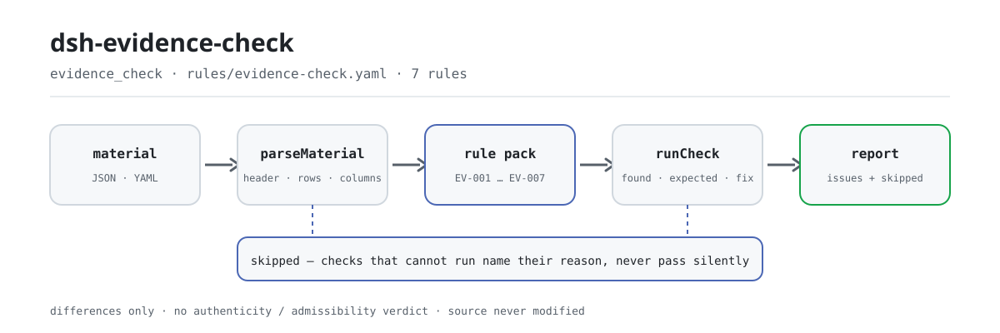

<div align="center">

<picture>
  <source media="(prefers-color-scheme: dark)" srcset="docs/assets/dsh-evidence-check-flow-dark.svg">
  
</picture>

# dsh-evidence-check

**Confere uma lista de provas linha a linha —completude, origem, datas e numeração— e devolve qual linha, qual coluna e o que falta.**

Um plugin de verificação para DeepSeek Harness, feito para advogados e equipes de apoio processual: entra o cabeçalho do processo mais uma linha por prova, aplica-se um pacote de regras com citações literais e sai a lista de divergências que o próprio material permite apontar —sem tocar no original e sem emitir veredicto.

[Instalar](#instalação-em-três-passos) · [Configuração](#configuração) · [FAQ](#faq) · [简体中文](README.md) · [English](README.en.md) · [Español](README.es.md) · [Português](README.pt.md) · [हिन्दी](README.hi.md)

[](LICENSE)
[](#compatibilidade)
[](https://www.npmjs.com/package/dsh-evidence-check)
[](https://github.com/PerryLink/dsh-evidence-check/actions/workflows/ci.yml)
[](#compatibilidade)

[](https://github.com/PerryLink/dsh-evidence-check/stargazers)
[](https://www.npmjs.com/package/dsh-evidence-check)
[](https://dshfind.com/plugins/PerryLink/dsh-evidence-check?ref=badge)
[](https://securityscorecards.dev/viewer/?uri=github.com/PerryLink/dsh-evidence-check)
[](https://dsh.market/)
[](https://gitee.com/perrylink/dsh-evidence-check)

```sh
dsh plugin --profile <name> add dsh-evidence-check
```

</div>

<sub>Plugin da comunidade, sem afiliação com a DeepSeek. Repositório canônico: <https://github.com/PerryLink/dsh-evidence-check> (o Gitee é um espelho).</sub>

## O que é

O `dsh-evidence-check` lê uma lista de provas —o cabeçalho do processo mais uma linha por prova— e verifica a completude e a coerência interna dessa lista: se cada prova traz nome e o fato que pretende provar (`claim`, `exhibitName`), se o seu `source` está registrado, se o seu `form` vem do vocabulário que você configurar, se `obtainedAt` é analisável e não é posterior a `submittedAt`, se não há `exhibitNo` repetido, se o cabeçalho declara `caseNo` e `party` e se não resta nenhum marcador de modelo na coluna do fato. Devolve a lista do que está incoerente, onde e o que corrigir; não modifica o original, não faz requisições de rede e não chama nenhum modelo. Não decide se a prova é autêntica, se foi obtida licitamente ou se é pertinente, nem se prova o fato, nem se deve ser admitida ou excluída: isso é o juízo do tribunal depois do contraditório.

## Instalação em três passos

1. **Instalar**:

   ```sh
   dsh plugin --profile <name> add dsh-evidence-check
   ```

   A verificação também é uma parte de «Documents and Governance Suite» no WorkBuddy / Coze (disponibilidade conforme esse mercado).

2. **Configuração mínima** (os padrões já funcionam):

   ```yaml
   - insert:
       - id: dsh-evidence-check
         name: dsh-evidence-check
   ```

   Todos os parâmetros ajustáveis ficam no esquema Schemastery de `src/config.ts` e funcionam como vêm; os limites por regra estão no pacote de regras em `rules/`.

3. **Verificar que montou**:

   ```sh
   dsh --profile <name> --dump-config | grep 'dsh-evidence-check'
   ```

   Depois execute uma vez o exemplo incluído (cerca de um minuto):

   ```sh
   node samples/quickstart/run.mjs
   ```

   ```text
   $ node samples/quickstart/run.mjs
   evidence_check: 1 issue(s) — error 0, warn 1, info 0
   skipped: 1
   ```

   A entrada do exemplo está em `samples/quickstart/input/`, a saída esperada em `samples/quickstart/expected/result.json` e a captura da primeira execução em [`docs/assets/quickstart.png`](docs/assets/quickstart.png).

**Desinstalar**: `dsh plugin --profile <name> remove dsh-evidence-check` (ou remova a linha do patch do perfil).

## Capacidades principais

O plugin registra a ferramenta `evidence_check`: lê uma lista de provas (cabeçalho do processo mais uma linha por prova), aplica um pacote de regras versionado e devolve um relatório estruturado. O material é JSON ou YAML; toda verificação que não pôde executar aparece em `skipped` com o motivo.

- **O pacote de regras é dados** — as sete verificações ficam em `rules/evidence-check.yaml`, então trocar o conjunto de regras não exige mexer no código; o pacote é validado na carga, não é presumido.
- **A gravidade segue a evidência** — uma regra baseada em princípio derivado (`derived-from-principle`) fica limitada a `warn`; uma baseada em configuração institucional (`institutional-configuration`) fica limitada a `info`; nenhuma é rotulada `error` (há um teste que o afirma).
- **Lista vazia não significa «nada errado»** — cada verificação que não pode rodar se declara em `skipped` com o motivo; `EV-003` vem de fábrica com `values` vazio, portanto se declara em `skipped` em vez de passar em silêncio.
- **Sem linguagem que adjudique** — o relatório lista diferenças e nunca se pronuncia sobre conformidade, responsabilidade ou acerto; um guarda de redação obriga o relatório a trazer sempre o seu aviso.
- **Sem citações inventadas** — cada regra carrega `document` / `number` / `clause` / `excerpt` / `kind` / `source`; `excerpt` tem de ser citação literal, e quando o texto não está em mãos o pacote diz isso em vez de apresentar paráfrase como citação.

```text
lista de provas (JSON/YAML) ──evidence_check──▶ regras EV-001…EV-007 ──▶ relatório (issues + skipped)
         ▲                                                                         │
         └──────────────────────────── original somente leitura, nunca alterado ───┘
```

### Regras em resumo

| Regra | O que verifica | Gravidade | Tipo de base |
|---|---|---|---|
| `EV-001` | cada prova se nomeia e enuncia seu fato | warn | cláusula literal |
| `EV-002` | cada prova registra sua origem | warn | cláusula literal |
| `EV-003` | a forma vem do seu vocabulário (desligada por padrão) | info | configuração institucional |
| `EV-004` | a data de obtenção é analisável e não posterior à de apresentação | warn | princípio derivado |
| `EV-005` | os números de prova são únicos na lista | warn | princípio derivado |
| `EV-006` | a lista declara número do processo e parte que a apresenta | warn | princípio derivado |
| `EV-007` | a coluna do fato não guarda marcadores não substituídos | warn | princípio derivado |

### Exemplos

Estas são as entradas reais do plugin; instale uma vez e chame uma. A saída abaixo é a execução real do plugin sobre o seu próprio fixture de teste `EV-001`, não uma ilustração.

**Saída detalhada** — ferramenta `evidence_check`, entrada:

```json
{"rows":[{"证据编号":"证1","待证事实":"","证据名称":""}]}
```

Saída:

```json
{
  "id": "dsh-evidence-check.EV-001.de09b5a6",
  "ruleId": "EV-001",
  "severity": "warn",
  "locator": {
    "field": "claim",
    "row": 1
  },
  "found": "第 1 行 claim、exhibitName 都为空",
  "expected": "claim、exhibitName 至少应填写一项",
  "fix": "补填证据名称与待证事实；本条只核对是否填写，不判断证据是否足以证明"
}
```

*Observed from `tests/fixtures/EV-001/EV-001-unsafe.json (cases.json expects EV-001 count 1); run via lib/index.mjs rules/evidence-check.yaml`*

### O que ele responde

| Você pergunta | O que ele responde |
|---|---|
| Entregamos dentro do prazo fixado pelo tribunal. Esta ferramenta confirma isso? | Não. `EV-004` verifica apenas que as duas colunas de data que a própria lista traz são analisáveis e que `obtainedAt` não é posterior a `submittedAt`; não calcula qualquer prazo probatório, porque esse prazo é fixado pelo tribunal ou acordado pelas partes, com prorrogações e suspensões próprias. Uma leitura dia a dia da lista não constitui, por isso, uma conclusão sobre a tempestividade. |
| O nome da prova está preenchido, mas a coluna do fato está vazia. | `EV-001` abrange `claim` e `exhibitName` em conjunto e pede apenas que pelo menos um dos dois esteja preenchido; reporta a linha em que ambas as células estão vazias e não julga se a prova basta para provar o fato. |
| Duas linhas trazem o mesmo número de prova. | `EV-005` compara os valores de `exhibitNo` dentro da lista, ignorando espaços, e reporta a linha posterior juntamente com aquela que duplica. Apenas estabelece que o número não é único: se é um registro duplicado ou um número mal copiado, cabe a você decidir. Uma célula de número vazia não entra nessa comparação. |
| A origem desta prova é óbvia e, mesmo assim, a regra dispara. | Porque a célula de origem não está preenchida. `EV-002` exige um `source` em cada prova a que a lista dê essa coluna; verifica que a célula tem conteúdo, não que a fonte seja lícita ou que o modo de obtenção tenha sido regular. |
| A nossa lista não traz número do processo nem parte que a apresenta no cabeçalho. | `EV-006` lê o cabeçalho e reporta qual de `caseNo` e `party` o material não declara. Verifica a declaração, não se o declarado está correto, e uma declaração em falta é reportada uma só vez para o cabeçalho, não linha a linha. |
| Que regra reporta `skipped` e por quê? | `EV-003` fá-lo de origem: os seus `values` vêm vazios, ou seja, o vocabulário de formas não está configurado, e o plugin não codifica uma lista de classes de prova porque os processos civil, administrativo e penal não enumeram as mesmas. Preencha `values` com as classes do seu processo e a regra passa a correr; a partir daí verifica apenas que cada célula `form` é uma delas, não a que classe pertence realmente uma prova. |

## Configuração

Todos os parâmetros ajustáveis ficam no esquema Schemastery de `src/config.ts`, portanto mudam pelo `cordis.yml` sem editar código; os limites por regra ficam no pacote de regras em `rules/`. São exatamente cinco chaves de configuração, na tabela abaixo; os parâmetros por regra vêm a seguir.

| Chave | Tipo | Padrão | Descrição |
|---|---|---|---|
| `rulesFile` | string | `rules/evidence-check.yaml` | Caminho do pacote de regras, relativo à raiz do pacote |
| `disabledRules` | string[] | `[]` | Ids de regras a desativar; cada uma aparece em `skipped` |
| `onlyRules` | string[] | `[]` | Executar apenas estas regras; vazio executa todas |
| `skipNotes` | string | `""` | Nota acrescentada a cada motivo de `skipped` |
| `timeoutMs` | number | `120000` | Orçamento de tempo limite cooperativo da ferramenta |

Parâmetros por regra que vale conhecer:

- `EV-003` `values` — as classes de prova do seu processo; vazio significa que a regra não roda e aparece em `skipped`. Exemplo de processo civil:

  ```yaml
  values: [书证, 物证, 视听资料, 电子数据, 证人证言, 鉴定意见, 勘验笔录]
  ```

- `EV-004` `field` / `notAfterField` — o par de datas, por padrão obtenção contra apresentação; o mesmo dia conta como não posterior.
- `EV-007` `terms` — os marcadores a procurar:

  ```
  terms: ['【', '】', '{{', '}}', 'XXX', '待填', 'TBD']
  ```

## FAQ

<details>
<summary>O meu material será alterado ou enviado?</summary>

Não. A ferramenta só lê o texto JSON/YAML que você entrega e **nunca modifica o original**; o plugin é ESM puro, sem código nativo, **sem rede e sem chamada ao modelo** (ver «Compatibilidade»), portanto o material não sai da sua máquina.

</details>

<details>
<summary>Sem vocabulário de formas configurado, vai passar em silêncio?</summary>

Não. `EV-003` traz `values` vazio de fábrica, então a regra se declara em `skipped` com o motivo: uma lista de diferenças vazia não pode ser lida como «não falta nada». Preencha `values` com as classes do seu processo e a regra começa a rodar; a partir daí verifica apenas que cada célula `form` é uma delas, não a que classe pertence realmente uma prova.

</details>

<details>
<summary>O plugin está instalado mas a ferramenta não aparece. O que fazer?</summary>

Confirme que `main` resolve para `lib/index.mjs` e que `pnpm run build` o gerou; um `main` errado faz o carregador pular a entrada em silêncio.

</details>

<details>
<summary>A instalação diz que o pacote é incompatível. O que fazer?</summary>

A faixa de peers cobre `0.1.x` e `0.2.x`; se o seu runtime ficar fora dela, conceda isenção explícita: `dsh plugin --profile <name> allow-version dsh-evidence-check@0.1.0 --dsh-version <runtime> --accept-risk`. A compatibilidade de peers na instalação é aplicada pelo runtime.

</details>

<details>
<summary>Dá para conferir uma lista inteira, ou um diretório inteiro, de uma vez?</summary>

A ferramenta funciona em modo `native` e `ptc`; para um conjunto grande de documentos convém `ptc`, assim o custo do esquema é pago uma vez. Toda a aritmética é de hora local sobre as cadeias fornecidas, sem conversão de fuso horário.

</details>

## Normas que segue

| Documento | Número | Regras que o citam |
|---|---|---|
| Providências do Tribunal Popular Supremo sobre a prova no processo civil | Fa Shi [2019] No. 19 (o estado de verificação de versão e numeração difere por regra — ver o campo `number` de cada regra) | EV-001, EV-002, EV-004, EV-005, EV-006, EV-007 |
| Providências do Tribunal Popular Supremo sobre a prova no processo civil | Fa Shi [2019] No. 19 (em vigor desde 1 de maio de 2020) | EV-003 |

**Limite:** este plugin confere uma **lista de provas** no que uma lista pode ser exigida mecanicamente: que cada prova se nomeie e enuncie o fato que pretende provar, que a sua origem fique registrada, que a sua forma venha do seu vocabulário, que a obtenção preceda a apresentação, que os números de prova sejam únicos, que a lista nomeie o processo e a parte que a apresenta, e que não sobreviva nenhum marcador. **Não** decide se a prova é autêntica, se foi obtida licitamente ou se é pertinente, nem se prova o fato, nem se deve ser admitida ou excluída. **Isso é o juízo do tribunal depois do contraditório, e é o núcleo do caso.**

> ### ⚠️ Leia isto antes de confiar numa citação do relatório
>
> **O estado do `excerpt` é por regra, não uniforme.** Algumas regras citam a cláusula literalmente (`kind: direct`), outras derivam do princípio dos artigos citados (`kind: derived-from-principle`, teto `warn`) e outras usam limites que a sua instituição configura (`kind: institutional-configuration`, teto `info`). O pacote nunca parafraseia uma citação: quando o texto não foi obtido, o campo `excerpt` diz isso e o raciocínio fica em `note`; há um teste que afirma que nenhuma regra reivindica uma citação que não tem. **Para qualquer regra ainda marcada como não obtida, substitua o `excerpt` pela cláusula real e eleve `kind` para `direct` assim que tiver o texto.**
>
> A conclusão é do revisor: este plugin lista diferenças que consegue apontar no material e não decide fatos nem conformidade.

## Formato do material

A ferramenta aceita JSON ou YAML:

```yaml
caseNo: （2026）某民初 1234 号
caseName: 买卖合同纠纷
party: 原告某某公司
rows:
  - { 证据编号: 证1, 待证事实: 双方于 2025 年 3 月 10 日签订买卖合同,
      证据名称: 买卖合同原件, 证据形式: 书证, 来源: 原告留存，签订时取得,
      页码: 第 1-3 页, 原件: 原件, 取得日期: 2025-03-10, 提交日期: 2026-03-02 }
```

Os nomes de coluna são comparados sem diferenciar maiúsculas e ignorando espaços, sublinhados e hífens; os nomes próprios da lista são mantidos, de modo que cada achado nomeia a coluna que leu. As datas podem ser `2026-03-02` ou `2026-03-02 09:30`. Os campos são opcionais na camada de leitura e validados pelo motor, então uma exportação parcial produz achados sobre o que falta em vez de falhar.

## Fontes das regras

Os dados das regras ficam em `rules/evidence-check.yaml`, separados do código. Cada regra carrega o documento, o seu número, a cláusula na numeração própria da fonte, um `excerpt` literal, uma URL de origem e um tipo de base (`kind`). O carregador impõe que o `excerpt` seja citação real de pelo menos oito caracteres e que uma verificação baseada apenas em princípio derivado (`derived-from-principle`, gravidade limitada a `warn`) ou em configuração institucional (`institutional-configuration`, limitada a `info`) nunca seja rotulada `error`. Um pacote que exagera a sua base falha na carga em vez de produzir um relatório de aparência segura.

A porta `check:citations` exige ainda que cada segmento do excerpt seja encontrado literalmente no registro de verificação de cláusulas em `rules/evidence/`; `rules/citations-baseline.json` registra os segmentos ainda não rastreáveis, e essa base só pode encolher.

As cláusulas citadas vêm das Providências do Tribunal Popular Supremo sobre a prova no processo civil (Fa Shi [2019] No. 19): artigos 1, 11, 14 e 19, mais os artigos pertinentes à lista entre o 50 e o 57. Os limites confirmados na verificação e as conclusões deliberadamente não tiradas estão em `rules/evidence/`.

## Compatibilidade

| Superfície | Estado |
|---|---|
| Harness | Faixa de peers `>=0.1.2-rc.1 <0.2.0 \|\| >=0.2.0-0 <0.3.0` — verificada para aceitar tanto `0.2.0-rc.2` quanto `0.2.1-rc.2`. `engines.dsh` é declarado como `>=0.2.1-0 <0.3.0` e o host o aplica desde 0.2.1 |
| Node | `^22.19.0 \|\| >=24.0.0` |
| Plataformas | Todas (ESM puro; sem código nativo, sem rede, sem chamada ao modelo) |
| Modo de ferramenta | Funciona em `native` e `ptc`; para um conjunto grande de documentos convém `ptc`, assim o custo do esquema é pago uma vez |

## Solução de problemas

- **`EV-003` nunca roda.** O seu vocabulário está vazio. As classes de prova diferem entre o processo civil, o administrativo e o penal, então o plugin não impõe uma lista; preencha os `values` do seu processo no pacote de regras.
- **`EV-004` dispara embora eu tenha apresentado dentro do prazo.** A regra não conhece o prazo; só compara as duas células de data que a lista traz. Se a obtenção for realmente posterior à apresentação, uma das duas está errada.
- **`EV-002` dispara numa prova cuja origem é óbvia.** Uma célula de origem vazia significa que a lista não diz de onde veio a prova, que é exatamente o que uma lista deve dizer.
- **`EV-005` dispara duas vezes no mesmo número de prova.** Numerar um anexo complementar com o mesmo número é comum; corrija o número em vez de confiar na observação.
- **O plugin instala mas a ferramenta não aparece.** Confirme que `main` resolve para `lib/index.mjs` e que `pnpm run build` o gerou; um `main` errado faz o carregador pular a entrada em silêncio.
- **`dsh plugin add` recusa o pacote por incompatível.** A faixa de peers cobre `0.1.x` e `0.2.x`; se o seu runtime ficar fora dela, conceda isenção explícita: `dsh plugin --profile <name> allow-version dsh-evidence-check@0.1.0 --dsh-version <runtime> --accept-risk`
- **Uma regra não rodou.** Leia o arranjo `skipped`; ele nomeia o id da regra e o motivo.
- **`check` informa `manifest-peers` como falha.** O verificador estático compara com uma faixa de peers codificada anterior à linha 0.2; o runtime aplica a compatibilidade de peers na instalação. É um problema conhecido do `dsh-plugin-dev`.
- **Os horários parecem deslocados.** Toda a aritmética é de hora local sobre as cadeias fornecidas, sem conversão de fuso horário.

## Ecossistema e qualidade

- [Espelho no Gitee](https://gitee.com/perrylink/dsh-evidence-check) (espelho sincronizado; o GitHub é a referência)
- [Página do plugin no dshfind](https://dshfind.com/plugins/PerryLink/dsh-evidence-check) (instalações e ranking)
- [Relatório do OpenSSF Scorecard](https://securityscorecards.dev/viewer/?uri=github.com/PerryLink/dsh-evidence-check) (gerado por [.github/workflows/scorecard.yml](.github/workflows/scorecard.yml))
- [DSH Market](https://dsh.market/) (publicado)
- [Base de conhecimento do ecossistema · escolha um verificador por material](https://perrylink.github.io/zh/checkers/choose/) (a família inteira: verificadores e plugins gerais)

## Desenvolvimento

```sh
pnpm install
pnpm run typecheck   # tsc --noEmit
pnpm test            # vitest; cada regra tem fixtures conformes/infratores em tests/fixtures/<RULE>/
pnpm run build       # tsdown -> lib/index.mjs + lib/index.d.mts
pnpm run check:readmes   # consistência dos README em cinco idiomas
node ../scripts/sync-shared.mjs dsh-evidence-check   # atualiza src/shared a partir de ../_shared
```

O plugin é **somente dados**: `src/model.ts` declara a forma da tabela, o kit compartilhado fornece o leitor e o motor de verificação, e o pacote de regras declara cada verificação. O pacote de regras é dados, não código: substituir `rules/*.yaml` troca o conjunto de regras sem tocar em TypeScript, e o pacote é validado na carga em vez de presumido. As imagens do README são geradas programaticamente por [`scripts/gen-readme-assets.py`](scripts/gen-readme-assets.py) (Python + Pillow) e podem ser reexecutadas; este plugin não tem interface, então o hero é um diagrama de fluxo SVG desenhado à mão (claro e escuro, apenas com tokens da superfície de comandos).

Tópicos: `dsh`, `dsh-plugin`, `deepseek-harness`, `cordis`, `evidence`

## Família e agradecimentos

Este projeto faz parte da família de plugins de DeepSeek Harness da [PerryLink](https://github.com/PerryLink) (todos Apache-2.0). Se ele for útil, **uma estrela ajuda a próxima pessoa a encontrá-lo** — nada fica bloqueado por isso.

- [@PerryLink](https://github.com/PerryLink) — criador e mantenedor: a ferramenta `evidence_check`, o pacote de regras com citações literais e o seu registro de verificação de cláusulas, e a documentação em cinco idiomas.

<details>
<summary>Expandir todos os plugins</summary>

| Plugin | Estado |
|---|---|
| **[dsh-aqua-input-check](https://github.com/PerryLink/dsh-aqua-input-check)** |  |
| **[dsh-archive-check](https://github.com/PerryLink/dsh-archive-check)** |  |
| **[dsh-auto-review](https://github.com/PerryLink/dsh-auto-review)** |  |
| **[dsh-autotier](https://github.com/PerryLink/dsh-autotier)** | 🧊 CONGELADO — ver o README do repo |
| **[dsh-bid-ca-precheck](https://github.com/PerryLink/dsh-bid-ca-precheck)** |  |
| **[dsh-bid-qual-check](https://github.com/PerryLink/dsh-bid-qual-check)** |  |
| **[dsh-cert-mcp](https://github.com/PerryLink/dsh-cert-mcp)** | 🧊 CONGELADO — ver o README do repo |
| **[dsh-checkpoint-rewind](https://github.com/PerryLink/dsh-checkpoint-rewind)** |  |
| **[dsh-click](https://github.com/PerryLink/dsh-click)** |  |
| **[dsh-composer-history](https://github.com/PerryLink/dsh-composer-history)** |  |
| **[dsh-contract-stance](https://github.com/PerryLink/dsh-contract-stance)** |  |
| **[dsh-customs-doc-check](https://github.com/PerryLink/dsh-customs-doc-check)** |  |
| **[dsh-data-quality](https://github.com/PerryLink/dsh-data-quality)** | 🧊 CONGELADO — ver o README do repo |
| **[dsh-demurrage-ledger](https://github.com/PerryLink/dsh-demurrage-ledger)** |  |
| **[dsh-doublecheck](https://github.com/PerryLink/dsh-doublecheck)** |  |
| **[dsh-drill-script-check](https://github.com/PerryLink/dsh-drill-script-check)** |  |
| **[dsh-eia-guide-check](https://github.com/PerryLink/dsh-eia-guide-check)** |  |
| **[dsh-emergency-plan](https://github.com/PerryLink/dsh-emergency-plan)** |  |
| **[dsh-essay-rubric-check](https://github.com/PerryLink/dsh-essay-rubric-check)** |  |
| **[dsh-evidence-check](https://github.com/PerryLink/dsh-evidence-check)** |  |
| **[dsh-export-ctl-check](https://github.com/PerryLink/dsh-export-ctl-check)** |  |
| **[dsh-fast](https://github.com/PerryLink/dsh-fast)** |  |
| **[dsh-fmea-table-check](https://github.com/PerryLink/dsh-fmea-table-check)** |  |
| **[dsh-forecast-penalty](https://github.com/PerryLink/dsh-forecast-penalty)** |  |
| **[dsh-fund-research](https://github.com/PerryLink/dsh-fund-research)** |  |
| **[dsh-github](https://github.com/PerryLink/dsh-github)** |  |
| **[dsh-gongwen-flow-check](https://github.com/PerryLink/dsh-gongwen-flow-check)** |  |
| **[dsh-gongwen-word-check](https://github.com/PerryLink/dsh-gongwen-word-check)** |  |
| **[dsh-guard-plan-qc](https://github.com/PerryLink/dsh-guard-plan-qc)** |  |
| **[dsh-hazchem-check](https://github.com/PerryLink/dsh-hazchem-check)** |  |
| **[dsh-hazplan-check](https://github.com/PerryLink/dsh-hazplan-check)** |  |
| **[dsh-hidden-risk-map](https://github.com/PerryLink/dsh-hidden-risk-map)** |  |
| **[dsh-hs-classify](https://github.com/PerryLink/dsh-hs-classify)** |  |
| **[dsh-icd-rule-check](https://github.com/PerryLink/dsh-icd-rule-check)** |  |
| **[dsh-industry-research](https://github.com/PerryLink/dsh-industry-research)** |  |
| **[dsh-lawcite-adapter](https://github.com/PerryLink/dsh-lawcite-adapter)** |  |
| **[dsh-laya](https://github.com/PerryLink/dsh-laya)** |  |
| **[dsh-lc-doc-check](https://github.com/PerryLink/dsh-lc-doc-check)** |  |
| **[dsh-learning-gap-check](https://github.com/PerryLink/dsh-learning-gap-check)** |  |
| **[dsh-library](https://github.com/PerryLink/dsh-library)** |  |
| **[dsh-local-ai](https://github.com/PerryLink/dsh-local-ai)** |  |
| **[dsh-lsp-actions](https://github.com/PerryLink/dsh-lsp-actions)** |  |
| **[dsh-mask](https://github.com/PerryLink/dsh-mask)** |  |
| **[dsh-mcp-panel](https://github.com/PerryLink/dsh-mcp-panel)** |  |
| **[dsh-medrec-qc](https://github.com/PerryLink/dsh-medrec-qc)** |  |
| **[dsh-memento](https://github.com/PerryLink/dsh-memento)** | 🧊 CONGELADO — ver o README do repo |
| **[dsh-nsfc-form-check](https://github.com/PerryLink/dsh-nsfc-form-check)** |  |
| **[dsh-nurse-record-check](https://github.com/PerryLink/dsh-nurse-record-check)** |  |
| **[dsh-observe](https://github.com/PerryLink/dsh-observe)** |  |
| **[dsh-origin-rvc-check](https://github.com/PerryLink/dsh-origin-rvc-check)** |  |
| **[dsh-ota-review-check](https://github.com/PerryLink/dsh-ota-review-check)** |  |
| **[dsh-output-styles](https://github.com/PerryLink/dsh-output-styles)** |  |
| **[dsh-paper-doc-adapter](https://github.com/PerryLink/dsh-paper-doc-adapter)** |  |
| **[dsh-permission-rules](https://github.com/PerryLink/dsh-permission-rules)** |  |
| **[dsh-permit-report-check](https://github.com/PerryLink/dsh-permit-report-check)** |  |
| **[dsh-pipeline-check](https://github.com/PerryLink/dsh-pipeline-check)** |  |
| **[dsh-pleading-draft](https://github.com/PerryLink/dsh-pleading-draft)** |  |
| **[dsh-plugin-doctor](https://github.com/PerryLink/dsh-plugin-doctor)** | 🚫 APOSENTADO (repo arquivado) |
| **[dsh-plugin-guide](https://github.com/PerryLink/dsh-plugin-guide)** |  |
| **[dsh-plugin-kit](https://github.com/PerryLink/dsh-plugin-kit)** | 🚫 APOSENTADO (repo arquivado) |
| **[dsh-plugin-upgrade](https://github.com/PerryLink/dsh-plugin-upgrade)** | 🚫 APOSENTADO (repo arquivado) |
| **[dsh-policy-brief-draft](https://github.com/PerryLink/dsh-policy-brief-draft)** |  |
| **[dsh-power-loss-split](https://github.com/PerryLink/dsh-power-loss-split)** |  |
| **[dsh-power-ticket-check](https://github.com/PerryLink/dsh-power-ticket-check)** |  |
| **[dsh-ppap-check](https://github.com/PerryLink/dsh-ppap-check)** |  |
| **[dsh-protest-deadline](https://github.com/PerryLink/dsh-protest-deadline)** |  |
| **[dsh-railway-window](https://github.com/PerryLink/dsh-railway-window)** |  |
| **[dsh-repair-order-qc](https://github.com/PerryLink/dsh-repair-order-qc)** |  |
| **[dsh-research-report](https://github.com/PerryLink/dsh-research-report)** |  |
| **[dsh-review-reply-check](https://github.com/PerryLink/dsh-review-reply-check)** |  |
| **[dsh-rulefile-check](https://github.com/PerryLink/dsh-rulefile-check)** |  |
| **[dsh-safety-brief-check](https://github.com/PerryLink/dsh-safety-brief-check)** |  |
| **[dsh-score](https://github.com/PerryLink/dsh-score)** | 🧊 CONGELADO — ver o README do repo |
| **[dsh-session-sync](https://github.com/PerryLink/dsh-session-sync)** |  |
| **[dsh-site-log-check](https://github.com/PerryLink/dsh-site-log-check)** |  |
| **[dsh-skill-pack-security](https://github.com/PerryLink/dsh-skill-pack-security)** |  |
| **[dsh-soe-decision-check](https://github.com/PerryLink/dsh-soe-decision-check)** |  |
| **[dsh-soilwater-check](https://github.com/PerryLink/dsh-soilwater-check)** |  |
| **[dsh-sop-sync-check](https://github.com/PerryLink/dsh-sop-sync-check)** |  |
| **[dsh-spc-gbt-adapter](https://github.com/PerryLink/dsh-spc-gbt-adapter)** |  |
| **[dsh-talk](https://github.com/PerryLink/dsh-talk)** |  |
| **[dsh-tender-extract](https://github.com/PerryLink/dsh-tender-extract)** |  |
| **[dsh-tender-matrix](https://github.com/PerryLink/dsh-tender-matrix)** |  |
| **[dsh-test-drive](https://github.com/PerryLink/dsh-test-drive)** |  |
| **[dsh-ticktick](https://github.com/PerryLink/dsh-ticktick)** | 🚫 APOSENTADO (repo arquivado) |
| **[dsh-translate](https://github.com/PerryLink/dsh-translate)** |  |
| **[dsh-warranty-calc](https://github.com/PerryLink/dsh-warranty-calc)** |  |
| **[dsh-budget](https://github.com/PerryLink/dsh-budget)** | 🧊 CONGELADO — ver o README do repo |
| **[dsh-claude-move](https://github.com/PerryLink/dsh-claude-move)** | 🧊 CONGELADO — ver o README do repo |
| **[dsh-defend](https://github.com/PerryLink/dsh-defend)** | 🧊 CONGELADO — ver o README do repo |
| **[dsh-draw](https://github.com/PerryLink/dsh-draw)** | 🧊 CONGELADO — ver o README do repo |
| **[dsh-reach](https://github.com/PerryLink/dsh-reach)** | 🧊 CONGELADO — ver o README do repo |
| **[dsh-background-agents](https://github.com/PerryLink/dsh-background-agents)** | 🚫 APOSENTADO (repo arquivado) |
| **[dsh-session-pin](https://github.com/PerryLink/dsh-session-pin)** | 🚫 APOSENTADO (repo arquivado) |
| **[dsh-team-rooms](https://github.com/PerryLink/dsh-team-rooms)** | 🚫 APOSENTADO (repo arquivado) |

</details>

## Licença

[LICENSE](LICENSE) (Apache License 2.0) © 2026 dsh-evidence-check contributors

<p align="center"><sub>Apache-2.0 · Plugin da comunidade, sem afiliação com a DeepSeek.</sub></p>
